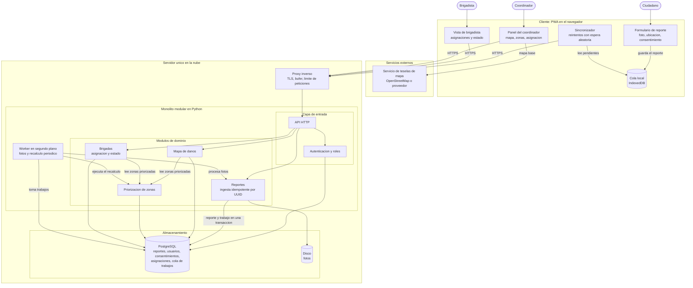
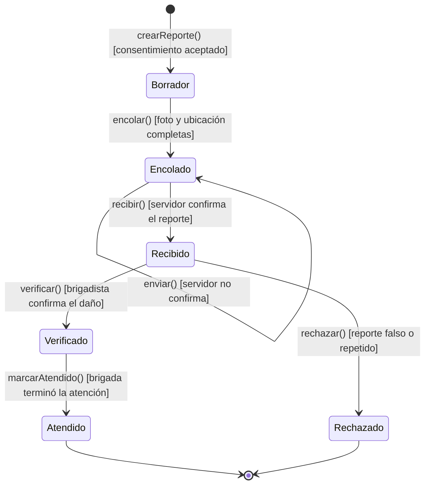
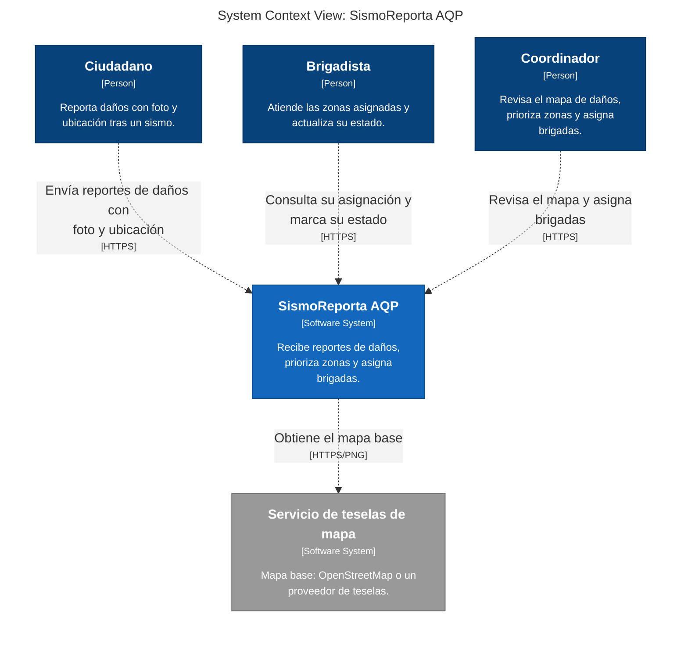

# <Nombre del caso> — Laboratorio 04: Fundamentos de arquitectura de software
Construcción de Software · EPIS-UNSA · 2026-B · Grupo 06
## Integrantes
| Nombre | Rol en el laboratorio (p. ej., redactor de ADR, diagramador, verificador de IA) |
|Oliva Valdivia David Alexander|Desarrollador,verificador de IA |
## Caso
SismoReporta AQP es una plataforma de reporte ciudadano de daños tras un sismo en Arequipa, pensada para apoyar a Defensa Civil.
El ciudadano envía reportes con foto y geolocalización desde una PWA que funciona sin señal y los reenvía al recuperarla.
El coordinador ve los daños en un mapa, recibe una priorización automática de zonas y asigna brigadas, y el brigadista actualiza el estado de su asignación.
El sistema lo construye un solo desarrollador en un mes, sobre un único servidor de bajo costo, y debe cumplir la Ley 29733 de protección de datos personales.
**Atributo de calidad crítico:** disponibilidad ante picos. Tras un sismo llegan unos 20 000 reportes en la primera hora con la red móvil congestionada, y cada reporte perdido retrasa la ayuda (QA-01).
## Arquitectura elegida

## Decisiones arquitectónicas
- [ADR-001: Estilo arquitectónico](docs/architecture/adr/001-estilo-arquitectonico.md)
- [ADR-002: Cola de Trabajos en PostgreSQL](docs/architecture/adr/002-cola-de-traajos-en-postgresql.md)
- [ADR-003: ...](docs/architecture/adr/003-pwa-offline-first.md)
## Diseño UML (Lab 05)

Diseño detallado de la historia [HU-01: Enviar un reporte sin señal y sincronizarlo](docs/design/historia.md).

### Diagrama de estados de `Reporte`

Fuente: [estado-estadoReporte.mmd](docs/design/estado-estadoReporte.mmd)

### Demás diagramas

| Diagrama | Fuente | Imagen |
|---|---|---|
| Clases | [clases.puml](docs/design/clases.puml) | [clases.png](docs/design/img/clases.png) |
| Secuencia | [secuencia-reporte.puml](docs/design/secuencia-reporte.puml) | [secuencia-reporte.png](docs/design/img/secuencia-reporte.png) |
| Actividades | [actividades-brigada.puml](docs/design/actividades-brigada.puml) | [actividades-brigada.png](docs/design/img/actividades-brigada.png) |
| Paquetes | [paquetes.puml](docs/design/paquetes.puml) | [paquetes.png](docs/design/img/paquetes.png) |
| Clases generadas desde el código | [classes_en.puml](docs/design/classes_en.puml) | [classes_en.png](docs/design/img/classes_en.png) |

### Código y verificación

- [reportes.py](src/reportes.py): esqueleto en Python generado a partir del diagrama de clases.
- [round-trip.md](docs/design/round-trip.md): diferencias entre el diagrama de diseño y el generado desde el código.
- [consistencia.md](docs/design/consistencia.md): revisión de las reglas C1 a C5 entre los cinco diagramas.
- [bitacora-ia.md](docs/design/bitacora-ia.md): registro de las interacciones con la IA.
- [ADR-004: Puerto ConsultaZonasAsignadas](docs/architecture/adr/004-puerto-priorizacion-brigadas.md): resolución del ciclo entre priorización y brigadas.
## Arquitectura C4 (Lab 06)

Modelo C4 de SismoReporta AQP en [workspace.dsl](docs/architecture/c4/workspace.dsl), validado y exportado con Structurizr CLI.

### Diagrama de contexto

Fuente: [structurizr-Contexto.mmd](docs/architecture/c4/export/structurizr-Contexto.mmd)

### Vistas

| Vista | Imagen |
|---|---|
| Contexto | [structurizr-Contexto.png](docs/architecture/c4/img/structurizr-Contexto.png) |
| Contenedores | [structurizr-Contenedores.png](docs/architecture/c4/img/structurizr-Contenedores.png) |
| Componentes de la API | [structurizr-Componentes.png](docs/architecture/c4/img/structurizr-Componentes.png) |
| Dinámica: SincronizarReporte (HU-01) | [structurizr-SincronizarReporte.png](docs/architecture/c4/img/structurizr-SincronizarReporte.png) |
| Despliegue en Producción | [structurizr-Despliegue.png](docs/architecture/c4/img/structurizr-Despliegue.png) |

## Patrones de diseño (Lab 07)

Refactor del flujo HU-01, de [antes/servicio.py](src/modulo/antes/servicio.py) a la versión después en [src/modulo/](src/modulo/). Las decisiones están en [ADR-005: Patrones de diseño adoptados y rechazados](docs/architecture/adr/005-patrones-de-diseno.md) y los olores, en [olores.md](docs/design/patrones/olores.md).

### Olor → patrón → prueba

| Olor o necesidad | Patrón | Prueba |
|---|---|---|
| El servicio conoce los formatos de IndexedDB, HTTP y PostgreSQL | Adapter ([adaptadores.py](src/modulo/adaptadores.py)) | [test_comportamiento.py](tests/test_comportamiento.py): 12 pruebas de caracterización que pasan en las dos versiones |
| Cada servicio crea sus dependencias concretas, y cambiar un servicio externo obliga a modificarlo | Strategy ([puertos.py](src/modulo/puertos.py)) y Factory ([fabrica.py](src/modulo/fabrica.py)) | [test_patrones.py](tests/test_patrones.py): `test_open_closed_nuevo_almacen_del_servidor_sin_modificar_el_servicio` |
| El estado es un texto y nada impide transiciones inválidas en el ciclo de seis estados del Lab 05 | State ([estados.py](src/modulo/estados.py)) | Sin prueba |
| El controlador imprime los mensajes con `print` | Observer ([eventos.py](src/modulo/eventos.py)) | Sin prueba; aún no está conectado al flujo |
| No queda registro de cada intento de envío para medir QA-01 | Decorator `EnvioConRegistro` ([decoradores.py](src/modulo/decoradores.py)) | Sin prueba; aún no está conectado al flujo |
| El sistema dependería de un proveedor de LLM concreto | Strategy y Adapter ([ia/puerto.py](src/modulo/ia/puerto.py), [ia/adaptador_llm.py](src/modulo/ia/adaptador_llm.py)) | Sin prueba |
| El LLM se consultaría de nuevo por cada descripción repetida | Decorator `ClasificadorConCache` ([ia/cache.py](src/modulo/ia/cache.py)) | Sin prueba |
| La respuesta del LLM se usaría sin revisar: categorías inventadas, estructuras declaradas seguras o datos personales | Chain of Responsibility ([ia/guardrails.py](src/modulo/ia/guardrails.py)) | Sin prueba |

### Métricas

Medidas con radon (`radon cc -s -a` y `radon raw -s`) sobre el código actual, sin contar las pruebas. El flujo equivalente reúne los archivos que reemplazan a `antes/servicio.py`: `servicio`, `modelo`, `puertos`, `adaptadores`, `fabrica`, `eventos` y `decoradores`.

| Versión | Archivos | Bloques analizados | Complejidad promedio | Complejidad máxima | SLOC |
|---|---|---|---|---|---|
| Antes | 1 | 27 | A (1,67) | A (5): `ServicioReportes.sincronizar_pendientes` | 189 |
| Después: flujo equivalente | 7 | 61 | A (1,77) | A (4): `ServicioReportes.__init__` | 331 |
| Después: máquina de estados (State) | 1 | 33 | A (1,33) | A (3): `Borrador.encolar` | 74 |
| Después: componente de IA | 4 | 25 | A (2,56) | B (6): `FormatoValido._verificar` | 139 |
| **Después: total** | **12** | **119** | **A (1,82)** | **B (6): `FormatoValido._verificar`** | **544** |

`sincronizar_pendientes` bajó de 5 a 3. Pruebas: 12 de caracterización antes del refactor; después, 13 funciones de prueba con 25 ejecuciones, todas pasan.

## Reflexión sobre el uso de la IA (5–8 líneas)
La IA seleccionada en este caso Claude Opus 5.5 y Claude Sonnet 5.5, se encargaron de la creacion de los diagramas, el analisis de los drivers iniciales, y la construccion de la matriz de decision, ademas ayudaron a automatizar procesos como la conversion de texto a markdown.
En definitiva el trabajo se agilizo utilizandolas para los procesos que no se tiene tanto conocimiento como el uso de mermaid y de puml.