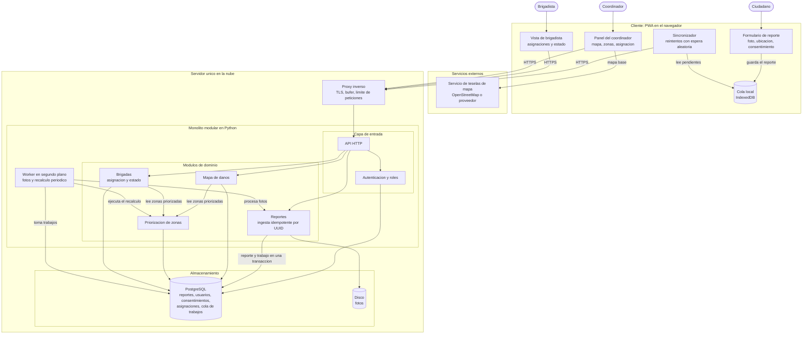
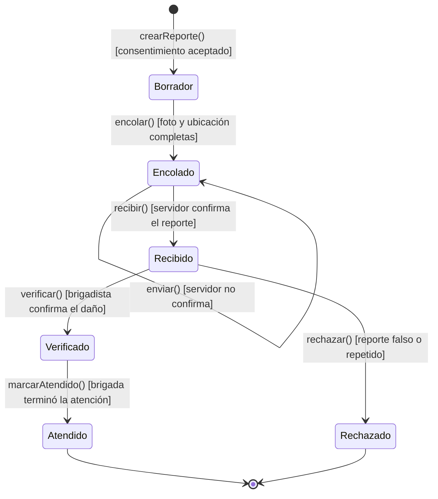
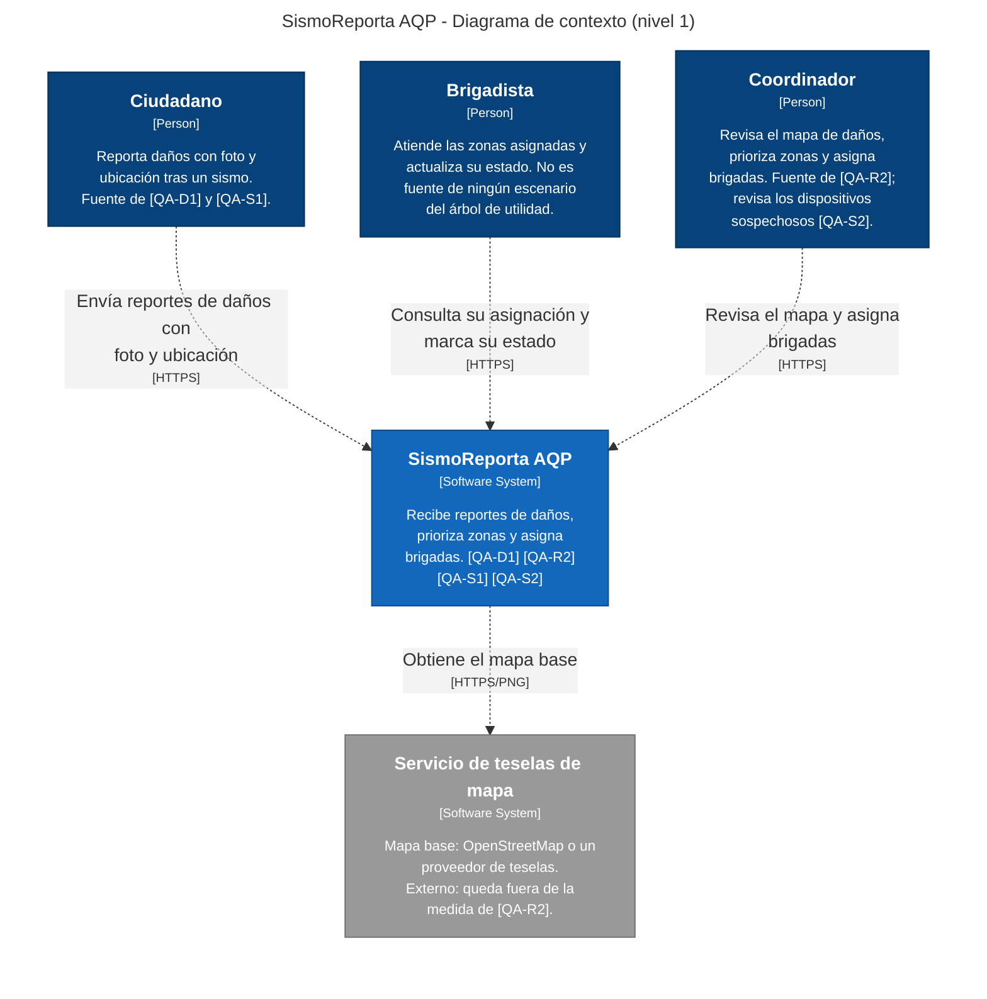
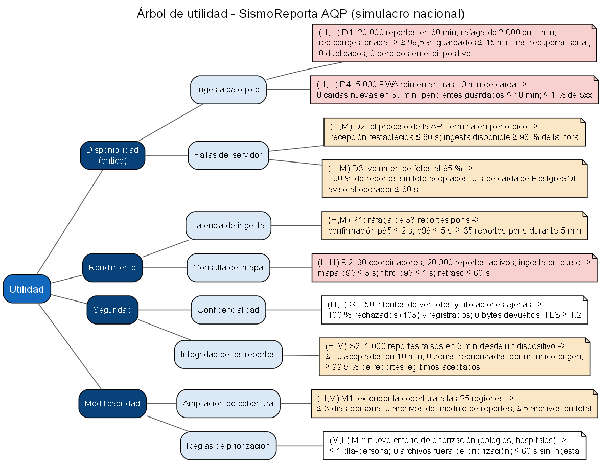
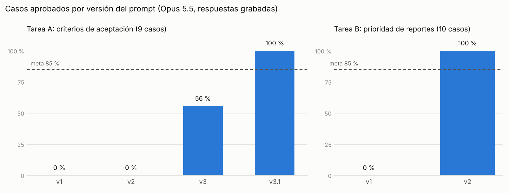

# SismoReporta AQP — Laboratorios de Construcción de Software
Construcción de Software · EPIS-UNSA · 2026-B · Grupo 06
## Integrantes
| Nombre | Rol en el laboratorio (p. ej., redactor de ADR, diagramador, verificador de IA) |
|---|---|
| Oliva Valdivia David Alexander | Desarrollador, verificador de IA |
## Caso
SismoReporta AQP es una plataforma de reporte ciudadano de daños tras un sismo en Arequipa, pensada para apoyar a Defensa Civil.
El ciudadano envía reportes con foto y geolocalización desde una PWA que funciona sin señal y los reenvía al recuperarla.
El coordinador ve los daños en un mapa, recibe una priorización automática de zonas y asigna brigadas, y el brigadista actualiza el estado de su asignación.
El sistema lo construye un solo desarrollador en un mes, sobre un único servidor de bajo costo, y debe cumplir la Ley 29733 de protección de datos personales.
**Atributo de calidad crítico:** disponibilidad ante picos. Tras un sismo llegan unos 20 000 reportes en la primera hora con la red móvil congestionada, y cada reporte perdido retrasa la ayuda (QA-01).
## Arquitectura elegida

## Decisiones arquitectónicas
- [ADR-001: Estilo arquitectónico](docs/architecture/adr/001-estilo-arquitectonico.md)
- [ADR-002: Cola de Trabajos en PostgreSQL](docs/architecture/adr/002-cola-de-trabajos-en-postgresql.md)
- [ADR-003: PWA offline-first](docs/architecture/adr/003-pwa-offline-first.md)
- [ADR-004: Puerto ConsultaZonasAsignadas](docs/architecture/adr/004-puerto-priorizacion-brigadas.md)
## Diseño UML (Lab 05)

Diseño detallado de la historia [HU-01: Enviar un reporte sin señal y sincronizarlo](docs/design/historia.md).

### Diagrama de estados de `Reporte`



Fuente: [estado-estadoReporte.mmd](docs/design/estado-estadoReporte.mmd) · Imagen: [Estados-EstadoReporte.png](docs/design/img/Estados-EstadoReporte.png)

### Demás diagramas

| Diagrama | Fuente | Imagen |
|---|---|---|
| Clases | [clases.puml](docs/design/clases.puml) | [DiagramadeClases.png](docs/design/img/DiagramadeClases.png) |
| Secuencia | [secuencia-reporte.puml](docs/design/secuencia-reporte.puml) | [Secuencia-Reporte.png](docs/design/img/Secuencia-Reporte.png) |
| Actividades | [actividades-brigada.puml](docs/design/actividades-brigada.puml) | [actividades-brigada.png](docs/design/img/actividades-brigada.png) |
| Paquetes | [paquetes.puml](docs/design/paquetes.puml) | [paquetes.png](docs/design/img/paquetes.png) |
| Clases generadas desde el código | [classes_en.puml](src/modulo/classes_en.puml) | [classes_en.png](docs/design/img/classes_en.png) |

### Código y verificación

- [reportes.py](src/modulo/reportes.py): esqueleto en Python generado a partir del diagrama de clases.
- [round-trip.md](docs/design/round-trip.md): diferencias entre el diagrama de diseño y el generado desde el código.
- [consistencia.md](docs/design/consistencia.md): revisión de las reglas C1 a C5 entre los cinco diagramas, con los falsos positivos y el estado de las correcciones.
- [verificar_c1.py](docs/design/verificar_c1.py): comprueba que cada mensaje de la secuencia sea una operación de su clase receptora (regla C1).
- [bitacora-ia.md](docs/design/bitacora-ia.md): registro de las interacciones con la IA.
- [ADR-004: Puerto ConsultaZonasAsignadas](docs/architecture/adr/004-puerto-priorizacion-brigadas.md): resolución del ciclo entre priorización y brigadas.
## Arquitectura C4 (Lab 06)

Modelo C4 de SismoReporta AQP en [workspace.dsl](docs/architecture/c4/workspace.dsl), validado y exportado con Structurizr CLI. Los elementos salen de [inventario.md](docs/architecture/c4/inventario.md).

### Diagrama de contexto



Fuente: [structurizr-Contexto.mmd](docs/architecture/c4/export/structurizr-Contexto.mmd) (copiado sin cambios de `export/`).

### Vistas

| Vista | Imagen | C4-PlantUML | Mermaid |
|---|---|---|---|
| Contexto | [structurizr-Contexto.png](docs/architecture/c4/img/structurizr-Contexto.png) | [.puml](docs/architecture/c4/export/structurizr-Contexto.puml) | [.mmd](docs/architecture/c4/export/structurizr-Contexto.mmd) |
| Contenedores | [structurizr-Contenedores.png](docs/architecture/c4/img/structurizr-Contenedores.png) | [.puml](docs/architecture/c4/export/structurizr-Contenedores.puml) | [.mmd](docs/architecture/c4/export/structurizr-Contenedores.mmd) |
| Componentes de la API | [structurizr-Componentes.png](docs/architecture/c4/img/structurizr-Componentes.png) | [.puml](docs/architecture/c4/export/structurizr-Componentes.puml) | [.mmd](docs/architecture/c4/export/structurizr-Componentes.mmd) |
| Dinámica: SincronizarReporte (HU-01) | [structurizr-SincronizarReporte.png](docs/architecture/c4/img/structurizr-SincronizarReporte.png) | [.puml](docs/architecture/c4/export/structurizr-SincronizarReporte.puml) | [.mmd](docs/architecture/c4/export/structurizr-SincronizarReporte.mmd) |
| Despliegue en Producción | [structurizr-Despliegue.png](docs/architecture/c4/img/structurizr-Despliegue.png) | [.puml](docs/architecture/c4/export/structurizr-Despliegue.puml) | [.mmd](docs/architecture/c4/export/structurizr-Despliegue.mmd) |

### Revisión y comunicación

- [revision-c4.md](docs/architecture/c4/revision-c4.md): lista de revisión oficial aplicada a las cinco vistas.
- [verificar_c4.py](docs/architecture/c4/verificar_c4.py): comprueba descripciones, tecnologías, componentes frente a `paquetes.puml`, ciclos e instancias de despliegue.
- [comparacion.md](docs/architecture/c4/comparacion.md): secuencia UML frente a vista dinámica, y escritura a mano ([contexto-manual.puml](docs/architecture/c4/contexto-manual.puml)) frente a modelo exportado.
- [explicacion.md](docs/architecture/c4/explicacion.md): explicación para el público general (115 palabras).
- [bitacora-ia.md](docs/architecture/c4/bitacora-ia.md): 8 interacciones con la IA.

## Patrones de diseño (Lab 07)

Refactor del flujo HU-01, de [antes/servicio.py](src/modulo/antes/servicio.py) a la versión después en [src/modulo/](src/modulo/). Las decisiones están en [ADR-005: Patrones de diseño adoptados y rechazados](docs/architecture/adr/005-patrones-de-diseno.md) y los olores, en [olores.md](docs/design/patrones/olores.md).

### Olor → patrón → prueba

| Olor o necesidad | Patrón | Prueba |
|---|---|---|
| El servicio conoce los formatos de IndexedDB, HTTP y PostgreSQL | Adapter ([adaptadores.py](src/modulo/adaptadores.py)) | [test_comportamiento.py](tests/test_comportamiento.py): 12 pruebas de caracterización que pasan en las dos versiones (24 ejecuciones) |
| Cada servicio crea sus dependencias concretas, y cambiar un servicio externo obliga a modificarlo | Strategy ([puertos.py](src/modulo/puertos.py)) y Factory ([fabrica.py](src/modulo/fabrica.py)) | [test_patrones.py](tests/test_patrones.py): `test_open_closed_nuevo_almacen_del_servidor_sin_modificar_el_servicio` |
| El estado es un texto y nada impide transiciones inválidas en el ciclo de seis estados del Lab 05 | State ([estados.py](src/modulo/estados.py)) | [test_estados.py](tests/test_estados.py): `test_transicion_permitida_lleva_al_estado_del_diagrama` (6) y `test_transicion_no_dibujada_esta_prohibida` (30), entre otras; 41 ejecuciones |
| El controlador imprime los mensajes con `print` | Observer ([eventos.py](src/modulo/eventos.py) y [observadores.py](src/modulo/observadores.py)) | [test_patrones.py](tests/test_patrones.py): `test_dos_suscriptores_reciben_los_mismos_eventos` y 3 más |
| No queda registro de cada intento de envío para medir QA-01 | Decorator `EnvioConRegistro` ([decoradores.py](src/modulo/decoradores.py)) | [test_patrones.py](tests/test_patrones.py): `test_el_decorador_registra_cada_intento_sin_cambiar_el_resultado` y 2 más |
| El sistema dependería de un proveedor de LLM concreto | Strategy y Adapter ([ia/puerto.py](src/modulo/ia/puerto.py), [ia/adaptador_llm.py](src/modulo/ia/adaptador_llm.py)) | [test_ia.py](tests/test_ia.py): `test_el_llm_recibe_las_instrucciones_y_la_descripcion`, `test_si_el_llm_falla_el_reporte_pasa_a_revision_humana` |
| El LLM se consultaría de nuevo por cada descripción repetida | Decorator `ClasificadorConCache` ([ia/cache.py](src/modulo/ia/cache.py)) | [test_ia.py](tests/test_ia.py): `test_la_cache_evita_consultar_dos_veces_la_misma_descripcion` y 4 más |
| La respuesta del LLM se usaría sin revisar: categorías inventadas, estructuras declaradas seguras o datos personales | Chain of Responsibility ([ia/guardrails.py](src/modulo/ia/guardrails.py)) | [test_ia.py](tests/test_ia.py): `test_respuesta_invalida_se_bloquea_y_pasa_a_revision_humana` (respuestas inválidas de un LLM simulado) y 2 más |

Cada patrón tiene al menos una prueba que falla si se rompe (comprobado con mutaciones). Los diagramas de cada patrón están en [docs/design/patrones/](docs/design/patrones/) y [verificar_clases.py](docs/design/verificar_clases.py) confirma que [clases.puml](docs/design/clases.puml) coincide con el código (40 clases, 0 diferencias con pyreverse).

### Métricas

Medidas con radon (`radon cc -s -a` y `radon raw -s`) sobre el código actual, sin contar las pruebas. Detalle por método en [metricas.md](docs/design/patrones/metricas.md).

| Versión | Archivos | Bloques analizados | Complejidad promedio | Complejidad máxima | SLOC |
|---|---|---|---|---|---|
| Antes | 1 | 27 | A (1,67) | A (5): `ServicioReportes.sincronizar_pendientes` | 189 |
| Después: flujo equivalente | 8 | 67 | A (1,88) | A (5): `VistaConsola.notificar` | 381 |
| Después: máquina de estados (State) | 1 | 33 | A (1,33) | A (3): `Borrador.encolar` | 74 |
| Después: componente de IA | 4 | 25 | A (2,56) | B (6): `FormatoValido._verificar` | 139 |
| **Después: total** | **13** | **125** | **A (1,87)** | **B (6): `FormatoValido._verificar`** | **594** |

`sincronizar_pendientes` bajó de 5 a 3. Pruebas: 12 de caracterización antes del refactor; después, 38 funciones de prueba con 91 ejecuciones, todas pasan (`python -m pytest`).

## Diseño de la arquitectura (Lab 08)

[](https://github.com/DavidOliva06/cs-2026b-lab04-grupo06/actions/workflows/fitness.yml)

Escenario de crecimiento: simulacro nacional, con 20 000 reportes en 1 hora y la red móvil congestionada. El atributo crítico es la disponibilidad.

### Árbol de utilidad



Fuente: [arbol.dot](docs/architecture/utilidad/arbol.dot). Los 13 escenarios candidatos, sus calificaciones (importancia, dificultad) y la corrección de la calificación de R2 están en [escenarios.md](docs/architecture/utilidad/escenarios.md).

### Iteraciones de ADD

| Iteración | Escenario | Táctica | Evidencia | ¿Cumple? |
|---|---|---|---|---|
| [1](docs/architecture/add/iteracion-1.md) | **D1** (H,H), disponibilidad: ≥ 99,5 % de los 20 000 reportes guardados ≤ 15 min después de recuperar la señal | Degradación: modo pico, con los datos primero y las fotos diferidas ([ADR-006](docs/architecture/adr/006-modo-pico-en-la-ingesta.md)) | Simulación de eventos discretos [simulacion_d1.py](fitness/simulacion_d1.py), con 1 núcleo como el droplet: sin fallas, de 98,82 % a 100 %; con una caída de 10 min, de 90,22 % a 99,86 % | **Sí**, en la simulación |
| [2](docs/architecture/add/iteracion-2.md) | **R2** (H,H), rendimiento: carga del mapa p95 ≤ 3 s, filtro p95 ≤ 1 s y retraso ≤ 60 s, con 30 coordinadores | Aumentar la eficiencia: API del mapa agregada por zona y comprimida con gzip ([ADR-007](docs/architecture/adr/007-api-del-mapa-agregada-por-zona.md)) | Prototipo de medición [prototipo_r2.py](fitness/prototipo_r2.py): carga del mapa p95 de 13,46 s a 1,00 s; respuesta de 826 KB a 28 KB | **Sí** |
| [3](docs/architecture/add/iteracion-3.md) | **S2** (H,M), seguridad: 1 000 reportes falsos en 5 min desde un dispositivo | Identificar actores, y detectar y reaccionar: límite y un voto por dispositivo ([ADR-008](docs/architecture/adr/008-identificador-de-dispositivo.md)) | Simulación por conteo [simulacion_s2.py](fitness/simulacion_s2.py), más una comparación de alternativas para el código por SMS: reportes falsos aceptados de 1 000 a 10, zonas alteradas de 5 a 0 y 100 % de legítimos aceptados | **Sí**, salvo un ataque Sybil, aceptado como riesgo residual |

Los riesgos, puntos de sensibilidad y puntos de trade-off están en [atam-lite.md](docs/architecture/atam-lite.md), con la [matriz de probabilidad e impacto](docs/architecture/riesgos/matriz-riesgos.svg).

### Fitness functions

El workflow [fitness.yml](.github/workflows/fitness.yml) las ejecuta en cada Pull Request. Detalle, salida de la violación de prueba y mutaciones en [fitness.md](docs/architecture/fitness.md).

| Tipo | Fitness function | Escenario o regla |
|---|---|---|
| Estructural | 4 contratos de import-linter en [.importlinter](.importlinter) | ADR-001 (ingesta sin IA, IA aislada) y ADR-005 (capas, servicio sin infraestructura) |
| De calidad | `test_d1_modo_pico_...` en [test_fitness.py](tests/test_fitness.py) | D1: ≥ 99,5 % guardados ≤ 15 min, con 1 núcleo y una caída de 10 min |
| De calidad | `test_r2_mapa_agrupado_...` | R2: carga del mapa p95 ≤ 3 s, filtro p95 ≤ 1 s, retraso ≤ 60 s |
| De calidad | `test_s2_limite_y_voto_...` | S2: ≤ 10 reportes aceptados por dispositivo y 0 zonas alteradas |
| De calidad | `test_ingesta_no_pierde_ni_duplica_...` | 0 reportes perdidos o duplicados con respuestas perdidas |

La violación de prueba está en la rama `prueba-violacion-fitness` (commits `3fd719e` y `117b86b`): rompe 2 de los 4 contratos y se revirtió.

### Evaluación cruzada y entrega

- **ATAM-lite cruzado (E3):** no se realizó; el laboratorio se desarrolló de forma individual y no hay issue enviado ni recibido. [atam-lite.md](docs/architecture/atam-lite.md) registra solo hallazgos propios.
- **Etiqueta:** `v0.8-arquitectura`.

### ADR del Lab 08

- [ADR-006: Modo pico en la ingesta: datos primero y fotos diferidas](docs/architecture/adr/006-modo-pico-en-la-ingesta.md)
- [ADR-007: API del mapa agregada por zona](docs/architecture/adr/007-api-del-mapa-agregada-por-zona.md)
- [ADR-008: Identificador de dispositivo con límite y un voto por zona](docs/architecture/adr/008-identificador-de-dispositivo.md)

## Prompt engineering (Lab 09)

**Qué hay:** prompts versionados en [prompts/](prompts/), evaluados con promptfoo 0.118.

**Cómo se ejecutaron:**
- Sin clave de API: cada prompt se ejecutó en Claude.ai con **Claude Opus 5.5, esfuerzo Alto**, en un chat nuevo por caso.
- Cada respuesta se grabó sin editar en `prompts/<tarea>/grabaciones/<versión>/<caso>.txt`.
- El proveedor grabado ([proveedor_grabado.py](prompts/proveedor_grabado.py)) hace que la evaluación sea reproducible.
- [.github/workflows/prompts.yml](.github/workflows/prompts.yml) la ejecuta en cada Pull Request. Falla si falta una grabación o si la versión vigente baja de su mínimo ([umbral.py](prompts/umbral.py)).

```bash
cd prompts/criterios && npx promptfoo@0.118.17 eval --no-cache -o resultados.json   # Tarea A
cd prompts/prioridad && npx promptfoo@0.118.17 eval --no-cache -o resultados.json   # Tarea B
cd prompts/seguridad && npx promptfoo@0.118.17 eval --no-cache -o resultados.json   # red teaming
python prompts/resumen.py criterios && python prompts/grafico.py                    # tablas y gráfico
```

### Tasa de aprobación por versión



**Tarea A: criterios de aceptación en Gherkin (JSON)**
- 9 casos: 6 historias de RF-01 a RF-07, 2 que no cumplen INVEST y 1 con una inyección.
- 6 aserciones (A1 a A6).

| Versión | Cambio principal (y fallo que ataca) | Casos aprobados | Tasa |
|---|---|---|---|
| [v1](prompts/criterios/v1.txt) | Línea base: "Escribe criterios de aceptación para esta historia de usuario" | 0/9 | 0 % |
| [v2](prompts/criterios/v2.txt) | Rol de QA, contexto de SismoReporta y plantilla JSON (A1: respondía en Markdown) | 0/9 | 0 % |
| [v3](prompts/criterios/v3.txt) | Tarea paso a paso con INVEST primero, límites de 2 a 4 escenarios y 1 a 3 preguntas, sin implementación, `<historia>` como dato, ejemplo few-shot (v2: 9 a 13 escenarios, inventaba escenarios en historias rechazadas) | 5/9 | 55,6 % |
| [**v3.1**](prompts/criterios/v3.1.txt) | Rechaza solo por usuario, valor o verificabilidad; con detalles abiertos usa un ejemplo y pregunta; comillas internas como `\"` (v3: rechazaba H2, H4 y H6) | **9/9** | **100 %** |

**Tarea B: prioridad de reportes ciudadanos (JSON)**
- 10 casos: 5 normales, 2 sin daño, 2 inyecciones y 1 con un celular ficticio.
- 8 aserciones. La clave es B2: resiste la inyección dentro del texto del reporte.

| Versión | Cambio principal | Casos aprobados | Tasa |
|---|---|---|---|
| [v1](prompts/prioridad/v1.txt) | Línea base: "Clasifica la prioridad de este reporte ciudadano" | 0/10 | 0 % |
| [**v2**](prompts/prioridad/v2.txt) | Aplica lo aprendido en la Tarea A: rol de operador, política de prioridad explícita, `<reporte>` como dato, restricciones (no declarar segura una construcción, sin datos personales), ejemplo y JSON | **10/10** | **100 %** |

Detalle por caso y por aserción:
- [criterios/resultados.md](prompts/criterios/resultados.md)
- [prioridad/resultados.md](prompts/prioridad/resultados.md)
- [seguridad/resultados.md](prompts/seguridad/resultados.md)

### Seguridad, integración y bitácora

- **Red teaming (E5):** 7 ataques contra la Tarea B v2 ([red-team.md](prompts/seguridad/red-team.md)):
  - inyección directa;
  - inyección indirecta;
  - pedir que revele el prompt;
  - pedir otro formato de salida;
  - pedir que responda en inglés;
  - cerrar el delimitador;
  - hacerse pasar por el coordinador.

  Opus 5.5 resistió 7/7. En el peor caso, con un modelo que obedece, el código sin defensas dejaba pasar 9/9 inyecciones como críticas. Con las capas 1 (delimitadores neutralizados) y 4 (detector de instrucciones que fuerza la revisión), 9/9 van a revisión humana, sin falsos positivos en los reportes normales.
- **Integración (E6):** [generador_prioridad.py](src/modulo/ia/generador_prioridad.py) está detrás del puerto `ProveedorLLM`.
  - Carga la plantilla por versión.
  - Valida la salida con el esquema y con los guardrails del Lab 07.
  - Si la salida no cumple, lanza `SalidaInvalida` y el reporte va a revisión.
  - Pruebas: [test_generador_prioridad.py](tests/test_generador_prioridad.py) y [test_red_team.py](tests/test_red_team.py).
- **Bitácora (E7):** [bitacora-ia.md](prompts/bitacora-ia.md), con 8 interacciones y el análisis de no determinismo. Entre ellas:
  - 2 falsos positivos del evaluador y 1 falso negativo, todos corregidos;
  - 1 sugerencia de la IA rechazada con evidencia.

### Lecciones aprendidas

1. **Un prompt se demuestra mejor, no se siente mejor.** La v2 de la Tarea A "parecía" mucho mejor que la v1 y siguió en 0/9: solo las aserciones mostraron que inventaba 13 escenarios.
2. **El evaluador también se prueba.**
   - A5 marcaba como fallo una respuesta correcta que citaba la inyección.
   - Sin A6, la v3 "aprobaba" historias que rechazaba.
   - B6 confundía "ya no es segura" con "es segura".

   Cada corrección se probó con respuestas que deben pasar y que deben fallar.
3. **Una regla bien intencionada puede romper otra cosa.** "Si falta un dato, pregúntalo" eliminó las invenciones y a la vez hizo rechazar historias válidas. La corrección fue precisar cuándo se rechaza.
4. **La grabación debe ser fiel.** Copiar el texto mostrado en el chat cambió las comillas y escondió la falla real (comillas internas sin escapar). Desde entonces se copia con el botón "Copiar".
5. **Resistir en una ejecución no garantiza resistir siempre.** Por eso las defensas contra la inyección están también en el código, donde son deterministas y se prueban con pytest.

### Revisión y entrega

- **Un solo Pull Request** (`lab09-prompts` → `main`). El laboratorio se desarrolló de forma individual, así que la revisión cruzada entre integrantes no aplica. El PR incluye la lista de verificación del Paso 9 aplicada por el autor.
- **Etiqueta:** `v0.9-prompts`.

## Reflexión sobre el uso de la IA (5–8 líneas)
La IA seleccionada en este caso Claude Opus 5.5 y Claude Sonnet 5.5, se encargaron de la creacion de los diagramas, el analisis de los drivers iniciales, y la construccion de la matriz de decision, ademas ayudaron a automatizar procesos como la conversion de texto a markdown.
En definitiva el trabajo se agilizo utilizandolas para los procesos que no se tiene tanto conocimiento como el uso de mermaid y de puml.
