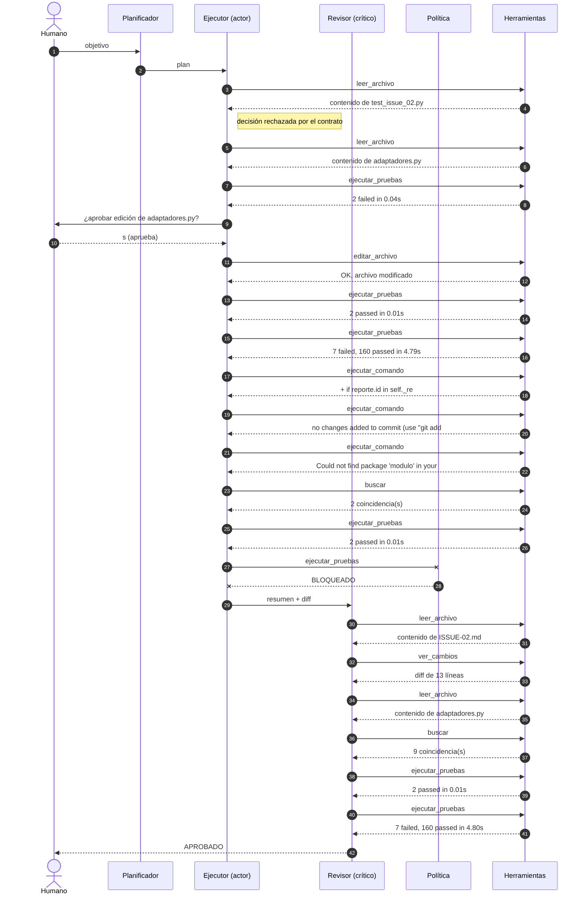

# Observación del sistema agéntico (Lab 10, E4, E5 y E7)

**Ejecuciones:**
- **Modelo:** las decisiones las tomó **Claude Opus 5.5** (esfuerzo Alto) en Claude.ai, con `ModeloInteractivo`: un chat nuevo por agente, entre el 17 y el 19/11/2026, en Windows y con Python 3.14.
- **Grabación:** cada decisión está en [trayectorias/](trayectorias) y cada aprobación humana, en `aprobaciones_*.json`.

**Fuentes de los datos:**
- **Métricas:** son las de las trazas **originales**, es decir, lo que vio el modelo: [evidencia/trazas-windows/](evidencia/trazas-windows), calculadas con `agente/traza.py`.
- **La ejecución `issue01/unico-extendidas`** se grabó después de ese envío. Sus métricas salen de la reproducción, y como no usó `ejecutar_comando`, sus observaciones coinciden con las originales salvo en los tiempos de pytest.
- **Reproducción:** `python agentes/reproducir.py` repite todas las trayectorias con `ModeloGrabado` y verifica el resultado de cada issue. El workflow `agentes.yml` lo hace en cada Pull Request.

## 1. Métricas de las trazas (3 issues)

| Ejecución | Issue | Variante | Pasos | Rondas | Herramientas usadas | Rechazadas por el contrato | Acciones bloqueadas | Aprobaciones humanas | Contexto final (caracteres) | Resultado |
|---|---|---|---|---|---|---|---|---|---|---|
| E2 | 1 | Agente único, herramientas base | 14 | — | leer_archivo 4, ejecutar_pruebas 3, editar_archivo 2, listar_archivos 1, ejecutar_comando 1 (lint-imports), ver_cambios 1 | 1 | 0 | — (sin aprobación) | 25 584 | **Resuelto** (7/7) |
| E4 + E6 | 1 | Agente único, herramientas extendidas, aprobación | 7 | — | leer_archivo 3, ejecutar_pruebas 1; **mapa_repo 0, notas 0** | 1 | 1 (rechazo humano) | 1 `n` (después de 1 respuesta inválida, "si") | 18 603 | Sin resolver: rechazo **provocado** para probar E6 |
| E4 | 3 | Agente único, herramientas extendidas, aprobación | 10 | — | leer_archivo 2, ejecutar_pruebas 3, editar_archivo 2, buscar 1, ver_cambios 1; **mapa_repo 0, notas 0** | 0 | 0 | 2 `s` | 13 981 | **Resuelto** (3/3) |
| E5 (a) | 2 | Agente único, aprobación | 10 | — | leer_archivo 2, ejecutar_pruebas 3, editar_archivo 1, ver_cambios 1, ejecutar_comando 1 (lint-imports) | 1 | 0 | 1 `s` | 17 138 | **Resuelto** (2/2) |
| E5 (b) | 2 | Gestor + actor-crítico, aprobación | 1 + 13 + 7 = 21 | 1 de 2 | Ejecutor: leer_archivo 2, ejecutar_pruebas 4, editar_archivo 1, ejecutar_comando 3 (git diff, git status, lint-imports), buscar 1. Revisor: leer_archivo 2, ver_cambios 1, buscar 1, ejecutar_pruebas 2 | 1 | 1 (límite de 12 pasos del ejecutor) | 1 `s` | 4 944 + 21 101 + 17 446 = **43 491** | **Resuelto** (2/2); ejecutor en `LIMITE_ALCANZADO`, revisor `APROBADO` |
| E5 (b), intento 1 | 2 | Gestor + actor-crítico | 1 + 8 | — | Ejecutor: `git diff` dos veces con salida vacía | 0 | 0 | 1 `s` | — | Interrumpido (Ctrl+C); causa corregida en el sandbox |

**Totales:**
- 5 ejecuciones completas: 4 resolvieron su issue y 1 quedó sin resolver por un rechazo humano provocado.
- 4 decisiones rechazadas por el contrato: 2 con una llave `}` de más, 1 con dos objetos JSON en la misma respuesta y 1 con comillas tipográficas (“ ”).
- 0 acciones bloqueadas por intentar tocar `tests/` o por comandos fuera de la lista.
- Con los 3 cambios aprobados aplicados al código, la suite completa pasa: 167 pruebas, y `lint-imports` da 4 kept, 0 broken.

### Diagrama de una trayectoria (issue 2, gestor + actor-crítico)

Diagramas de las demás ejecuciones:
- [issue01/unico](trazas/issue01/unico/trayectoria.png)
- [issue01/unico-extendidas](trazas/issue01/unico-extendidas/trayectoria.png)
- [issue02/unico](trazas/issue02/unico/trayectoria.png)
- [issue03/unico](trazas/issue03/unico/trayectoria.png)

## 2. E4: efecto de `mapa_repo` y de las notas

| Medida | Issue 1 sin herramientas nuevas (E2) | Issue 1 con herramientas nuevas | Issue 3 con herramientas nuevas |
|---|---|---|---|
| Veces que el agente llamó a `mapa_repo`, `anotar` o `leer_notas` | — | 0 | 0 |
| Decisión en la que el agente propuso la primera edición | 5 | 6 (una decisión más por un rechazo del contrato) | 4 |
| Archivos leídos antes de editar | 3 (issue, prueba y `entrada.py`) | 3 (los mismos) | 2 (issue y `priorizacion.py`) |
| Costo fijo del catálogo de las 3 herramientas nuevas | 0 | 323 caracteres en el primer mensaje | 323 caracteres |

**Costo potencial, medido sobre el sandbox:**
- `mapa_repo("src/modulo")` devuelve 7 476 caracteres.
- Leer todo `src/modulo` con `leer_archivo` cuesta 70 346 caracteres, unas **9 veces más**.
- Los archivos que los agentes leyeron de verdad fueron mucho más chicos: `entrada.py` 5 889, `adaptadores.py` 4 770 y `priorizacion.py` 1 952 caracteres.

**Conclusión de E4:**
- Las dos herramientas están documentadas en `catalogo()` y probadas (6 pruebas), pero **no tuvieron efecto en estos issues**: el agente no las usó en ninguna de las 2 ejecuciones en que estaban disponibles.
- La causa es que cada issue nombra el archivo y la prueba. Lo más barato fue leer ese archivo, unos 2 000 a 6 000 caracteres, y no el mapa del módulo, de 7 476.
- La memoria de notas tampoco hizo falta: ninguna ejecución pasó de 14 pasos y todo el razonamiento cupo en el historial.
- `mapa_repo` se justifica en issues que **no** dicen dónde está el error. Ahí reemplaza a leer el módulo completo, que es 9 veces más caro.
- No se puede afirmar que reduzca pasos sin un issue de ese tipo; queda como trabajo pendiente.

## 3. E5: agente único frente a actor-crítico (issue 2)

| Medida | Agente único | Gestor + actor-crítico |
|---|---|---|
| Rondas del bucle actor-crítico | — | 1 de 2 (el revisor aprobó en la primera) |
| Pasos (decisiones) | 10 | 21 (1 + 13 + 7) |
| Acciones ejecutadas | 8 | 17 (11 del ejecutor + 6 del revisor) |
| Acciones bloqueadas | 0 | 1 (el ejecutor superó su límite de 12 pasos) |
| Decisiones rechazadas por el contrato | 1 | 1 |
| Contexto final | 17 138 caracteres | 43 491 caracteres (**2,5 veces** más) |
| Chats y pegados de la persona | 1 chat, 10 respuestas pegadas | 3 chats, 21 respuestas pegadas |
| Resultado | Resuelto: deduplica con `any()` sobre la lista | Resuelto: almacén indexado por id (dict) |
| ¿El revisor encontró algo que el agente único pasó por alto? | — | **No.** Su veredicto `APROBADO` confirma lo mismo que el agente único ya había verificado: las pruebas del issue pasan y las 7 fallas restantes son de los issues 1 y 3 |

**Conclusión (parsimonia):**
- Para el issue 2, el sistema de tres agentes llegó al mismo resultado que el agente único con el doble de pasos y 2,5 veces el contexto.
- Además, su ejecutor agotó el presupuesto de 12 pasos en verificaciones repetidas (git diff, git status, lint-imports y la suite dos veces) y terminó sin entregar su resumen.
- El revisor de solo lectura no aportó ningún hallazgo nuevo. La única diferencia entre los cambios, un dict en vez de una lista, vino del plan del planificador y no de la crítica.
- La separación entre quien escribe y quien revisa sí tiene valor como control. Pero en este caso ese control ya lo daban la prueba del issue, la protección de `tests/` y la aprobación humana de cada edición.
- **Por parsimonia, el agente único es la configuración por defecto** (ADR-010).
- El actor-crítico se reserva para cambios en archivos de riesgo (`adaptadores.py`, `entrada.py` y `dispositivos.py`), donde un segundo par de ojos puede justificar el costo.

## 4. Lo que mostraron las trazas (observabilidad)

1. **`git diff` vacío (primer intento multi):**
   - **Qué pasó:** la observación vacía hizo que el ejecutor repitiera la acción.
   - **Causa:** el sandbox no era un repositorio git propio y git miraba el repositorio real, donde `agentes/trabajo/` está ignorado.
   - **Corrección:** el sandbox ahora tiene su propio git, y un comando sin salida lo dice.
2. **`lint-imports` no disponible:**
   - **Qué pasó:** las 3 trazas originales muestran "no se reconoce como un comando". El agente concluyó que no estaba instalado y revisó ADR-005 a mano con `buscar`.
   - **En la reproducción en Linux** fallaba por otra razón: faltaba `PYTHONPATH`.
   - **Corrección:** la herramienta ejecuta import-linter con el mismo intérprete y `PYTHONPATH=src:src/modulo`.
3. **Presupuesto del ejecutor:**
   - **Qué pasó:** con 12 pasos, el ejecutor de la variante multi terminó en `LIMITE_ALCANZADO`, porque su plan le pedía verificar todo lo que después repetiría el revisor.
   - **Corrección pendiente:** el plan del ejecutor no debe incluir los pasos del revisor.
4. **Rechazo humano sin motivo:**
   - **Qué pasó:** tras la `n`, el agente no supo qué corregir y terminó "SIN RESOLVER".
   - **Corrección:** la consola pide un motivo opcional y el agente lo recibe en la observación del bloqueo.
5. **Las reproducciones coinciden con las originales** en todas las observaciones, salvo los tiempos de pytest y las 3 salidas de `lint-imports`. Ninguna diferencia cambia una decisión: las decisiones vienen de la grabación.
