# ADD, iteración 1: disponibilidad de la ingesta en el simulacro nacional

## Resumen

| Punto | Registro |
|---|---|
| Objetivo | Escenario **D1** (H,H): ≥ 99,5 % de 20 000 reportes guardados ≤ 15 min después de recuperar la señal; 0 duplicados; 0 perdidos en el dispositivo (sección 2) |
| Elemento refinado | Ingesta: PWA (cola local y sincronizador), proxy inverso, API de ingesta, worker y almacenamiento de fotos |
| Conceptos evaluados | T1 limitar la respuesta a eventos, T2 degradación (modo pico), T3 aumentar recursos, T4 redundancia pasiva (secciones 5 a 7) |
| Decisión | **T2 aceptada**; T1 aplazada por la evidencia; T3 y T4 rechazadas; se mantiene el estilo de ADR-001 (sección 8) |
| Evidencia | Simulación de eventos discretos [fitness/simulacion_d1.py](../../../fitness/simulacion_d1.py), con tablas y gráficos antes y después (sección 9) |
| ¿Se cumple D1? | **Sí en la simulación, con T2**, incluso con una caída del servidor de 10 min, que sin T2 baja a 97,47 %. La parte "0 perdidos en el dispositivo" queda sin evidencia (sección 10) |

## 1. Entradas

- **Drivers:** [drivers.md](../drivers.md), [escenarios.md](../utilidad/escenarios.md) y el [árbol de utilidad](../utilidad/arbol.png).
- **Decisiones vigentes:** [ADR-001](../adr/001-estilo-arquitectonico.md) (monolito modular con ingesta asíncrona en un servidor único), [ADR-002](../adr/002-cola-de-trabajos-en-postgresql.md) (cola de trabajos en PostgreSQL) y [ADR-003](../adr/003-pwa-offline-first.md) (PWA offline-first).
- **Restricciones:** 1 desarrollador con Python, JavaScript, CSS y PostgreSQL (R-02), MVP en 1 mes (R-01) y un servidor de US$ 20–30 al mes (R-03).

## 2. Objetivo de la iteración

Hay tres escenarios (H,H): D1, D4 y R2. El objetivo es **D1** por dos razones:

- La disponibilidad es el atributo crítico (n.º 1 en drivers.md) y D1 extiende QA-01.
- D4 es un caso de la recuperación de D1, y R2 pertenece al atributo n.º 2.

> **D1:** 20 000 reportes en 60 min, con una ráfaga de 2 000 en 1 min y la red móvil congestionada. Medida: ≥ 99,5 % de los reportes guardados en el servidor ≤ 15 min después de recuperar la señal; 0 duplicados; 0 reportes perdidos en el dispositivo.

**Elementos a refinar:** PWA (cola local y sincronizador), proxy inverso, API de ingesta, worker y almacenamiento de fotos.

## 3. Línea base: tácticas ya decididas

Estas tácticas ya están decididas y no entran como candidatas:

| Táctica (Bass et al.) | Dónde se decidió |
|---|---|
| Reintento con espera exponencial y aleatoria | ADR-003 |
| Transacciones e idempotencia por UUID | ADR-002 y ADR-003 |
| Ingesta que solo valida, guarda y responde | ADR-001 |
| Envío de los datos antes que la foto | ADR-003 |

## 4. Estimaciones de carga

Son estimaciones; la prueba de carga de `fitness/` debe confirmarlas.

| Dato | Valor | Supuesto |
|---|---|---|
| Ráfaga, solo datos | 33 reportes/s ≈ 33 KB/s | 1 KB por reporte |
| Ráfaga con fotos | 2 000 × 300 KB = 600 MB/min ≈ 80 Mbps | Foto comprimida de 300 KB |
| Subida de una foto | ≈ 48 s → 33/s × 48 s ≈ **1 600 conexiones simultáneas** | Subida de 50 kbps en red congestionada |
| Subida de los datos | ≈ 2 s → ≈ **66 conexiones simultáneas** | 0,16 s de transferencia más la latencia de la red |
| Capacidad de la ingesta de solo datos | ≈ 60–130 reportes/s (2 a 4 veces la ráfaga) | 2 vCPU, ≈ 30 ms por petición en Python |
| Fotos de la hora del simulacro | 20 000 × 300 KB ≈ 6 GB | |
| Caída tolerable del servidor sin romper D1 | 15 min − 2 min de espera máxima entre reintentos − envío ≈ **12 min** | Tope de espera de 2 min en la PWA |

**Conclusión:** el cuello de botella son las fotos y las conexiones lentas, no la CPU que procesa los datos.

## 5. Tácticas candidatas

| Táctica (Bass et al.) | Categoría | Qué es en este sistema |
|---|---|---|
| T1. Limitar la respuesta a eventos | Rendimiento: controlar la demanda | Sobre un umbral, el proxy y la API responden HTTP 429 con `Retry-After`, y la PWA respeta esa espera |
| T2. Degradación | Disponibilidad: recuperarse de fallas | Modo pico: el servidor acepta solo los datos, la PWA guarda la foto para después y el worker procesa solo la priorización |
| T3. Aumentar recursos | Rendimiento: gestionar recursos | Redimensionar el servidor (de 2 vCPU/4 GB a 8 vCPU/16 GB) durante 24–48 h alrededor del simulacro |
| T4. Redundancia pasiva | Disponibilidad: preparación y reparación | Segundo servidor con réplica de PostgreSQL por streaming y conmutación manual |

## 6. Análisis de trade-offs

### T1. Limitar la respuesta a eventos

- **Mejora:**
  - D1, porque el servidor no se satura; un 429 solo retrasa el envío.
  - D4 directamente: 5 000 pendientes con un límite de 35 reportes/s se reciben en ≈ 143 s (2,4 min), dentro de los 10 min de D4.
  - El p95 de R1 para las peticiones aceptadas.
- **Empeora:**
  - El ciudadano rechazado ve su reporte "pendiente" por más tiempo.
  - Un límite **por IP** rechazaría a ciudadanos legítimos que comparten IP en la red móvil (CGNAT, escenario S2), así que debe ser global o por dispositivo.
  - El `Retry-After` debe ser ≤ 2 min para no salirse de la ventana de 15 min.
- **Costo:** US$ 0; el proxy inverso ya está en la arquitectura del README.
- **Complejidad para 1 dev:** baja–media, 1–2 días-persona. Es la única configuración fuera de Python/JS/PostgreSQL, y el proxy ya estaba aceptado.
- **Punto de sensibilidad:** el valor del umbral. Si es bajo, rechaza reportes que el servidor podía recibir; si es alto, no protege contra la tormenta de D4.

### T2. Degradación (modo pico)

- **Mejora:**
  - D1: el tráfico por reporte baja unas 300 veces y las conexiones simultáneas pasan de ≈ 1 600 a ≈ 66.
  - D3: el disco deja de crecer ≈ 6 GB por hora durante el pico.
  - R1, y reduce la competencia entre el worker y la ingesta, que ADR-001 deja como riesgo.
- **Empeora:**
  - **Verificación del coordinador:** durante el pico ve reportes sin foto.
  - **Integridad (S2):** sin foto, la priorización depende solo de cuántos reportes hay por zona, así que los reportes falsos coordinados pesan más justo durante el pico.
  - **Fotos que nunca llegan:** ADR-003 no usa la sincronización en segundo plano, así que la foto solo se envía si el ciudadano vuelve a abrir la PWA, y mientras tanto el navegador puede borrarla. El reporte llega, pero parte de las fotos se pierde. No hay dato de cuántas.
  - **Diseño:** aparece un estado "foto pendiente" en el patrón State de [estados.py](../../../src/modulo/estados.py).
- **Costo:** US$ 0.
- **Complejidad para 1 dev:** media, 2–3 días-persona entre la PWA, la bandera del servidor y el worker.
- **Activación:** debe activarse sola por un umbral que el servidor pueda observar (en la simulación, ≥ 70 % de las conexiones del proxy ocupadas durante 10 s), porque el único desarrollador puede no estar disponible el día del evento (bitácora, costos ocultos).
- **Punto de trade-off:** disponibilidad de la ingesta frente a integridad y calidad de la información del coordinador.

### T3. Aumentar recursos (escalado vertical temporal)

- **Mejora:** da margen a D1, R1 y R2.
- **Empeora:**
  - Solo sirve en un evento planificado.
  - No elimina el punto único de falla.
  - Redimensionar exige minutos de caída.
  - Si se olvida bajar el plan, el servidor cuesta ≈ US$ 70–110 al mes, de 3 a 4 veces R-03 (supuesto: US$ 0,10–0,15 por hora).
- **Costo:** ≈ US$ 3–10 por simulacro.
- **Complejidad para 1 dev:** baja, ≈ 0,5 día-persona.

### T4. Redundancia pasiva

- **Mejora:** D1 y D2 si se pierde el servidor completo; la conmutación tomaría ≈ 5–10 min.
- **Empeora:**
  - Con réplica asíncrona se pueden perder los últimos reportes ya confirmados.
  - Con réplica síncrona, cada escritura suma la latencia entre los dos servidores (R1).
  - Las fotos en disco también deben replicarse.
  - Hay riesgo de que los dos servidores actúen como principal (*split-brain*).
- **Costo:** US$ 40–60 al mes.
- **Complejidad para 1 dev:** alta, 5–8 días-persona más la operación continua.

## 7. Tácticas rechazadas

### T4. Redundancia pasiva: rechazada

1. **Incumple R-03:** cuesta US$ 40–60 al mes frente al techo de US$ 30.
2. **Consume el plazo:** 5–8 días-persona son del 25 % al 40 % de los ≈ 20 días hábiles del mes del MVP (R-01).
3. **No ataca la causa de D1:** D1 falla por las fotos y las conexiones lentas (≈ 1 600 conexiones), no por la pérdida del servidor.
4. **El servidor único es tolerable para D1:** los reportes esperan en el celular mientras el servidor vuelva en ≤ 12 min. Un reinicio del proceso (D2, ≤ 60 s) entra con holgura. Perder el servidor completo justo en la hora del simulacro es poco probable (supuesto por verificar: SLA del proveedor ≥ 99,95 %, ≈ 22 min de caída al mes).
5. **Con réplica asíncrona contradice D2** ("0 reportes confirmados y luego perdidos"); la síncrona empeora R1.

### T3. Aumentar recursos temporalmente: rechazada

En la primera evaluación se propuso como margen para el simulacro. Se rechaza al reanalizarla:

1. **Invalida el simulacro como medición.** El simulacro existe para comprobar que el sistema aguanta un sismo real. En un sismo real nadie redimensiona el servidor antes, así que un simulacro con 4 veces los recursos aprueba D1 con una capacidad que no existirá el día que importa.
2. **No hace falta si las estimaciones se cumplen:** con T2, la ingesta de solo datos tiene una capacidad estimada de 60–130 reportes/s frente a una ráfaga de 33. Si la prueba de carga contradice esa estimación, el escalado debe ser **permanente**, y eso es una decisión de costo frente a R-03, no una táctica para el simulacro.
3. **Su riesgo operativo es el de T4 en pequeño:** depende de que una sola persona recuerde redimensionar antes del evento y volver a bajar el plan después; si se olvida, el costo mensual se multiplica por 3 o 4.

## 8. Decisión de la iteración

La primera versión de esta decisión aceptaba T1 y T2. La evidencia de la sección 9 cambió la decisión sobre T1.

| Táctica | Decisión | Motivo |
|---|---|---|
| T2. Degradación (modo pico) | **Aceptada** | Es la única táctica que hace cumplir D1 con una caída de 10 min (de 97,47 % a 100 %) y en la base baja el máximo de 298 s a 18 s |
| T1. Limitar la respuesta a eventos | **Aplazada** | No mejora D1 en ninguna variante simulada y alarga el máximo (de 18 s con T2 a 89 s con T1 + T2). Se reconsidera si la prueba de carga real muestra esperas expiradas (CPU saturada) o en la iteración de D4 |
| T3. Aumentar recursos temporalmente | Rechazada | Sección 7 |
| T4. Redundancia pasiva | Rechazada | Sección 7 |

Esfuerzo estimado: 2–3 días-persona (solo T2), US$ 0 adicionales.

**Se mantiene el estilo de ADR-001.** Cambiarlo a microservicios no agrega capacidad en el mismo servidor, y usar varios servidores incumple R-03. Se reconsideraría solo en estos casos:

- La prueba de carga con T2 da menos de 35 reportes/s. En ese caso se evalúa primero un servidor más grande de forma permanente, no un cambio de estilo.
- El requisito pasa a exigir sobrevivir a la pérdida del servidor completo con 0 reportes confirmados perdidos.
- El presupuesto supera los US$ 50 al mes.

## 9. Evidencia: simulación de eventos discretos

La guía propone adaptar una simulación del ejemplo, pero esa simulación no está en el repositorio, así que se construyó un modelo propio con los datos del caso: [fitness/simulacion_d1.py](../../../fitness/simulacion_d1.py). Solo usa la biblioteca estándar de Python.

```
python fitness/simulacion_d1.py           # 10 réplicas, sensibilidad, tablas y gráficos
python fitness/simulacion_d1.py --rapido  # 3 réplicas
```

Las tablas completas quedan en [fitness/resultados/d1.md](../../../fitness/resultados/d1.md) y los gráficos en [img/](img/).

### 9.1 Modelo

1. Cada reporte empieza cuando el ciudadano recupera la señal (t0). La PWA envía los datos y, cuando el servidor los confirma, la foto (ADR-003).
2. Cada intento abre una conexión en el proxy. Si las conexiones están llenas, el intento se rechaza y la PWA reintenta con espera exponencial y aleatoria.
3. La transferencia dura la latencia más el tamaño dividido entre la velocidad de subida. La red puede cortar la conexión durante la transferencia; en ese caso, la PWA reintenta.
4. Al terminar la transferencia, la petición entra en la cola de la API, que comparte los 2 núcleos con el único worker (ADR-001). La PWA espera la respuesta hasta 30 s.
5. El servidor guarda una sola vez cada UUID y descarta los duplicados (ADR-002 y ADR-003).
6. **Con T1**, una petición de datos sin ficha en el balde recibe HTTP 429 y la PWA reintenta según `Retry-After`.
7. **Con T2**, cuando el 70 % de las conexiones está ocupado durante 10 s, se activa el modo pico: las fotos que aún no se enviaron se difieren hasta después del simulacro.

### 9.2 Supuestos de la simulación

| Parámetro | Valor | Origen |
|---|---|---|
| Llegadas | 18 000 reportes uniformes en 60 min y 2 000 entre los minutos 20 y 21 | D1 |
| Horizonte | 75 min (60 de llegadas y 15 de la ventana de D1) | D1 |
| Latencia por intento | Lognormal, mediana 1,5 s, σ 0,5 | Supuesto: red congestionada |
| Velocidad de subida | Lognormal, mediana 50 kbps, σ 0,6 | Supuesto de la sección 4 |
| Cortes de conexión (falla) | 0,01 por s de conexión: falla ≈ 1,7 % de los envíos de datos y ≈ 39 % de los envíos de foto | Supuesto |
| Tamaños | Datos 1 KB; foto 300 KB | Sección 4 |
| Espera de respuesta en la PWA | 30 s | Supuesto |
| Reintentos | Espera aleatoria entre 0 y min(120 s, 2 s × 2ⁿ) | ADR-003 y tope de 2 min de la sección 4 |
| Conexiones del proxy | 1 000 simultáneas | Supuesto: proxy en un servidor de 2 vCPU |
| CPU del servidor | 2 núcleos compartidos entre la API y 1 worker | ADR-001 y R-03 |
| Tiempos de servicio (media, lognormal con cv 0,5) | Datos 30 ms; duplicado 10 ms; guardar foto 20 ms; procesar foto 150 ms (worker) | Supuesto de la sección 4 |
| T1 | 35 reportes/s, balde de 70, `Retry-After` entre 5 y 60 s | Sección 6 |
| T2 | Umbral del 70 % de las conexiones, muestreo cada 5 s, activo hasta el final | Sección 6 |
| Réplicas | 10 (semillas 1 a 10); 5 por variante en la sensibilidad | — |

**Fuera del modelo:** el borrado de IndexedDB en el celular, la caída del proceso de la API (D2), la red del operador como recurso compartido, el envío posterior de las fotos diferidas y los reportes falsos.

### 9.3 Resultados con los supuestos base

Medida de D1: porcentaje de reportes guardados ≤ 15 min después de recuperar la señal.

| Configuración | Guardados ≤ 15 min (media de 10) | Peor réplica | p95 hasta guardar | Máximo | Filas duplicadas | ¿Cumple D1? |
|---|---|---|---|---|---|---|
| Antes | 100,00 % | 100,00 % (20 000 de 20 000) | 10 s | 298 s | 0 | Sí |
| Solo T1 | 100,00 % | 100,00 % (20 000 de 20 000) | 10 s | 298 s | 0 | Sí |
| **Solo T2 (decisión)** | 100,00 % | 100,00 % (20 000 de 20 000) | 6 s | 18 s | 0 | Sí |
| T1 + T2 | 100,00 % | 100,00 % (20 000 de 20 000) | 6 s | 89 s | 0 | Sí |

| Configuración | Pico de conexiones | Conexiones rechazadas | Respuestas 429 | Esperas expiradas | Fotos guardadas | Fotos diferidas | Inicio del modo pico |
|---|---|---|---|---|---|---|---|
| Antes | 1 000 | 8 716 | 0 | 0 | 20 000 | 0 | — |
| Solo T1 | 1 000 | 8 763 | 3 | 0 | 20 000 | 0 | — |
| Solo T2 | 932 | 13 | 0 | 0 | 6 277 | 13 723 | min 20,3 |
| T1 + T2 | 932 | 9 | 170 | 0 | 6 275 | 13 725 | min 20,3 |



### 9.4 Resultados con una caída del servidor de 10 min (minutos 20 a 30, durante la ráfaga)

| Configuración | Guardados ≤ 15 min (media de 10) | Peor réplica | p95 hasta guardar | Máximo | ¿Cumple D1? |
|---|---|---|---|---|---|
| Antes | 97,58 % | 97,47 % (19 493 de 20 000) | 797 s | 1 199 s | **No** |
| Solo T1 | 97,45 % | 97,20 % (19 440 de 20 000) | 803 s | 1 179 s | No |
| **Solo T2 (decisión)** | 100,00 % | 100,00 % (20 000 de 20 000) | 641 s | 833 s | **Sí** |
| T1 + T2 | 100,00 % | 100,00 % (20 000 de 20 000) | 664 s | 864 s | Sí |


### 9.5 Sensibilidad (se cambia un supuesto a la vez; peor de 5 réplicas)

| Variante | Antes: guardados ≤ 15 min | Después (T2): guardados ≤ 15 min | Antes: p95 | Después (T2): p95 |
|---|---|---|---|---|
| Base | 100,00 % | 100,00 % | 10 s | 6 s |
| 500 conexiones | 99,94 % | 100,00 % | 232 s | 4 s |
| 2 000 conexiones | 100,00 % | 100,00 % | 7 s | 7 s |
| Cortes ×2 (0,02 por s) | 100,00 % | 100,00 % | 8 s | 6 s |
| Foto de 600 KB | 99,91 % | 100,00 % | 190 s | 4 s |
| Procesar foto 400 ms | 100,00 % | 100,00 % | 10 s | 12 s |
| Ráfaga de 4 000 en 1 min | 100,00 % | 100,00 % | 185 s | 43 s |
| Caída de 10 min en el minuto 20 | **97,56 %** | 100,00 % | 796 s | 641 s |
| Caída de 13 min en el minuto 20 | 90,90 % | **99,02 %** | 1 020 s | 836 s |

### 9.6 Lectura de la evidencia

1. **Con los supuestos base, la arquitectura actual ya cumple D1.** El proxy se satura 1–2 min durante la ráfaga (pico de 1 000 conexiones y ≈ 8 700 rechazos), pero los reintentos de ADR-003 recuperan todos los reportes en ≤ 298 s. T2 baja ese máximo a 18 s, así que el margen dentro de la ventana de 900 s pasa de 602 s a 882 s.
2. **El margen de T2 se vuelve necesario cuando algo falla.** Con una caída de 10 min, "Antes" guarda a tiempo el 97,47 % en la peor réplica y no cumple; con T2 se guarda el 100 %. Lo mismo, en menor medida, con 500 conexiones o fotos de 600 KB: "Antes" sigue cumpliendo, pero su p95 sube a 190–232 s, mientras que con T2 queda en ≤ 4 s.
3. **La caída tolerable es de ≈ 10 a 12 min.** Con 13 min de caída, ni T2 cumple (99,02 %). Esto confirma la estimación de la sección 4 y deja la protección contra caídas más largas en D2 (reiniciar el proceso en ≤ 60 s).
4. **T1 no aporta a D1.** Hay 0 esperas expiradas en todas las corridas, porque la CPU nunca es el cuello de botella; el cuello de botella son las conexiones ocupadas por fotos. T1 limita una petición barata y solo agrega espera: con caída, "Solo T1" queda peor que "Antes" (97,20 % frente a 97,47 %).
5. **La CPU no es el cuello de botella**, como estimaba la sección 4: procesar cada foto en 400 ms en vez de 150 ms no cambia el resultado de "Antes".
6. **El costo de T2 tiene tamaño:** en la base se difieren 13 723 de 20 000 fotos (69 %). Eso dimensiona RI-01.
7. **Duplicados:** en la simulación, las "0 filas duplicadas" se cumplen por construcción, porque el modelo guarda cada UUID una sola vez. La evidencia real de la idempotencia viene de las pruebas `test_confirmacion_perdida_no_duplica_el_reporte` y `test_servidor_recibe_dos_veces_el_mismo_reporte_y_guarda_uno` de [test_comportamiento.py](../../../tests/test_comportamiento.py); las 25 ejecuciones pasan.

## 10. ¿Se cumple el escenario D1?

| Parte de la medida de D1 | Antes | Después (T2) | Evidencia |
|---|---|---|---|
| ≥ 99,5 % guardados ≤ 15 min, supuestos base | Sí (100 %) | Sí (100 %) | Simulación, sección 9.3 |
| ≥ 99,5 % guardados ≤ 15 min, con caída de 10 min | **No (97,47 %)** | **Sí (100 %)** | Simulación, sección 9.4 |
| 0 duplicados | Sí | Sí | Pruebas de `test_comportamiento.py` |
| 0 reportes perdidos en el dispositivo | Sin evidencia | Sin evidencia | Fuera del modelo; ADR-003 ya advierte que no se puede garantizar (RI-05) |

**Conclusión:** D1 se cumple en la simulación con T2, con margen frente a caídas de hasta 10 min. Es evidencia de un modelo con parámetros supuestos, no de una prueba de carga sobre el sistema real (RI-03), y la parte "0 perdidos en el dispositivo" sigue sin evidencia.

## 11. Riesgos y pendientes

| ID | Riesgo o pendiente | Origen | Cómo se cierra |
|---|---|---|---|
| RI-01 | En la simulación base se difiere el 69 % de las fotos (13 723 de 20 000), y no se sabe cuántas llegan a enviarse después | T2 y ADR-003 | Medir el % de fotos recibidas ≤ 24 h después del simulacro |
| RI-02 | Durante el modo pico, los reportes falsos influyen más en la priorización | T2 y S2 | Llevarlo a la iteración de seguridad (S2) y a ATAM-lite (E3) |
| RI-03 | La simulación confirma que el cuello de botella son las conexiones, pero con parámetros supuestos | Sección 9.2 | Prueba de carga sobre el sistema real (E4) |
| RI-04 | El umbral de activación de T2 (70 % de las conexiones) no está calibrado | T2 | Calibrarlo con la prueba de carga |
| RI-05 | La meta de 0 reportes perdidos en el dispositivo no tiene evidencia | ADR-003 | Prueba en celulares de gama baja con almacenamiento casi lleno |
| RI-06 | D1 solo tolera caídas del servidor de ≈ 10 min | Sección 9.6 | Iteración de D2: reinicio del proceso en ≤ 60 s |

## 12. Lista de verificación

- [x] La evidencia usa la misma medida del escenario: % de reportes guardados ≤ 15 min después de recuperar la señal (y p95 en segundos como medida complementaria).
- [x] Los supuestos de la simulación están escritos (sección 9.2) y concentrados en la clase `Supuestos` del script.
- [x] Se muestra el escenario antes y después de la táctica, en tablas y gráficos.
