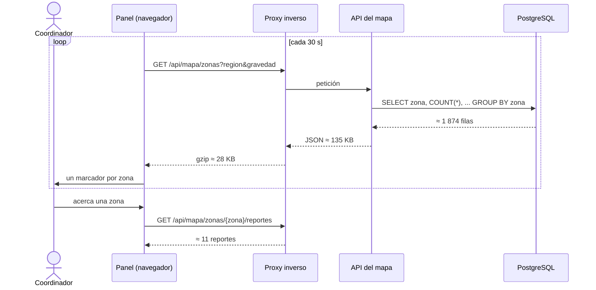

# ADD, iteración 2: rendimiento del mapa del coordinador

## Resumen

| Punto | Registro |
|---|---|
| Objetivo | Escenario **R2** (H,H): carga del mapa p95 ≤ 3 s, cambio de filtro p95 ≤ 1 s y retraso ≤ 60 s, con 30 coordinadores y 20 000 reportes activos (paso 2) |
| Elemento refinado | Módulo de mapa, API del mapa, panel del coordinador y proxy inverso (paso 3) |
| Conceptos evaluados | T5 aumentar la eficiencia (agrupar en el servidor), T6 mantener copias de los datos (resumen del worker), T7 mantener copias del cómputo (caché compartida), T8 aumentar recursos (réplica de lectura) (paso 4) |
| Decisión | **T5 aceptada**; T6, T7 y T8 rechazadas (paso 4) |
| Evidencia | Prototipo medible [fitness/prototipo_r2.py](../../../fitness/prototipo_r2.py) con tablas antes y después (paso 7) |
| ¿Se cumple R2? | **Sí con T5:** la carga del mapa pasa de 13,46 s a 1,00 s en el p95. Antes no cumple (paso 7) |

## Paso 1. Revisar las entradas

- **Drivers:** [escenarios.md](../utilidad/escenarios.md) y el [árbol de utilidad](../utilidad/arbol.png). R2 extiende QA-02 de [drivers.md](../drivers.md).
- **Decisiones vigentes:** ADR-001 a ADR-005 y la [iteración 1](iteracion-1.md) (T2, modo pico).
- **Restricciones:** R-01 (1 mes), R-02 (Python, JavaScript, CSS y PostgreSQL), R-03 (un servidor de US$ 20–30 al mes).

## Paso 2. Establecer el objetivo de la iteración

Después de D1 quedan dos escenarios (H,H): D4 y R2. Se elige **R2** por tres razones:

- Es el único (H,H) de un atributo que aún no se atendió (rendimiento, n.º 2 en drivers.md).
- Su dificultad se corrigió a H en E1 porque comparte el servidor con la ingesta.
- La simulación de la iteración 1 ya cubrió parte de D4: la recuperación tras una caída de 10 min.

> **R2:** 30 coordinadores abren el mapa nacional y lo refrescan cada 30 s, con la ingesta de R1 en curso y 20 000 reportes activos. Medida: carga del mapa p95 ≤ 3 s; cambio de filtro p95 ≤ 1 s; retraso ≤ 60 s entre que un reporte se guarda y aparece en el mapa.

## Paso 3. Elegir los elementos a refinar

| Elemento | Responsabilidad actual | Por qué se refina |
|---|---|---|
| Módulo de mapa y API del mapa | Devuelve los reportes activos | Con 20 000 reportes, la respuesta pesa 826 KB aun comprimida (paso 7) |
| Panel del coordinador | Dibuja el mapa y filtra por región y gravedad | Recibe y dibuja todos los reportes |
| Proxy inverso | TLS, búfer y límite de peticiones | Puede comprimir las respuestas |
| PostgreSQL | Guarda reportes y la cola de trabajos | Atiende a la vez la ingesta y el mapa (ADR-002, riesgo) |

**Línea base (antes):** la API devuelve el listado de reportes activos y el panel los agrupa y filtra en el navegador.

## Paso 4. Elegir los conceptos de diseño

### Tácticas candidatas (Bass et al., rendimiento)

| Táctica | Categoría | Qué es en este sistema |
|---|---|---|
| T5. Aumentar la eficiencia | Controlar la demanda de recursos | La API agrupa por zona en la consulta (un registro por zona, con el total y el conteo por gravedad) y el proxy comprime con gzip |
| T6. Mantener múltiples copias de los datos | Gestionar recursos | El worker recalcula cada 15 s una tabla `resumen_zona` y la API la lee |
| T7. Mantener múltiples copias del cómputo | Gestionar recursos | La respuesta de T5 se guarda en una caché compartida por todos los coordinadores durante 15 s |
| T8. Aumentar recursos | Gestionar recursos | Réplica de lectura de PostgreSQL en un segundo servidor para el mapa |

### Trade-offs

| Táctica | Mejora | Empeora | Costo | Complejidad (1 dev) |
|---|---|---|---|---|
| T5 | La carga del mapa pasa de 13,46 s a 1,00 s; la respuesta, de 826 KB a 28 KB comprimida; la CPU del mapa, de 35,8 % a 6,7 % de un núcleo | La vista nacional pierde el detalle por reporte: para verlo hay que acercarse a una zona, con una petición nueva. El filtro deja de ser local: pasa de 0 a 0,68 s, dentro del límite de 1 s | US$ 0 | Baja: 1–2 días-persona (una consulta con `GROUP BY`, un endpoint y la configuración de gzip) |
| T6 | Servidor p95 de 83 a 34 ms; CPU de 6,7 % a 2,6 % de un núcleo | El retraso sube de 31 a 46 s (gasta 15 s de los 60 de R2); el mapa depende de que el worker esté al día; agrega una tabla y una tarea periódica | US$ 0 | Media: 1–2 días-persona |
| T7 | CPU de 6,7 % a 0,5 % de un núcleo | El retraso sube de 31 a 46 s; cada filtro por región y gravedad es una entrada distinta de la caché, así que acierta menos de lo modelado; hay que invalidarla | US$ 0 | Media: 1 día-persona |
| T8 | Separa la lectura del mapa de la escritura de la ingesta | Duplica el costo; la réplica va con retraso; el cuello de botella medido es la red, no la base de datos | US$ 40–60 al mes, fuera de R-03 | Alta, como T4 en la iteración 1 |

### Decisión

| Táctica | Decisión | Motivo |
|---|---|---|
| **T5** | **Aceptada** | Es la única que ataca la causa medida: el tamaño de la respuesta. Hace cumplir R2 con margen (1,00 s frente a 3 s) |
| T6 | Rechazada | Mejora el p95 en 0,03 s y ahorra 4 puntos de un núcleo, pero cuesta 15 s del margen de retraso y agrega una dependencia del worker |
| T7 | Rechazada | Mejora el p95 en 0,06 s, a cambio de 15 s de retraso y de tener que invalidar la caché. Se reconsidera si los coordinadores pasan de ≈ 150: con T5 cada coordinador consume ≈ 0,22 % de un núcleo, y 150 llegarían a ≈ 33 % |
| T8 | Rechazada | Incumple R-03 y no ataca la causa: con T5 la base de datos usa el 6,7 % de un núcleo |

**Se mantiene el estilo de ADR-001.** T5 se implementa dentro del módulo de mapa.

## Paso 5. Instanciar elementos, asignar responsabilidades y definir interfaces

| Elemento | Responsabilidad nueva o cambiada |
|---|---|
| Módulo de mapa | Agrupa los reportes activos por zona en una sola consulta |
| API del mapa | Expone las dos interfaces de abajo |
| Panel del coordinador | Dibuja un marcador por zona con su total; al acercarse a una zona pide sus reportes; el filtro pide los datos al servidor; refresca cada 30 s |
| Proxy inverso | Comprime con gzip las respuestas `application/json` |
| PostgreSQL | Índices en `reporte(zona)` y `reporte(region)` |

**Interfaces:**

```
GET /api/mapa/zonas?region={id}&gravedad={1|2|3}
200 [{"zona": 101, "region": 4, "lat": -16.3989, "lon": -71.5370, "total": 37, "g": [22, 11, 4]}, ...]

GET /api/mapa/zonas/{zona}/reportes
200 [{"id": "<uuid>", "lat": -16.39891, "lon": -71.53702, "gravedad": 3, "estado": "Recibido", "recibido": "..."}, ...]
```

Ambas requieren el rol coordinador (RF-06, S1). El detalle por zona devuelve, en promedio, 20 000 / 1 874 ≈ 11 reportes.

## Paso 6. Bosquejar vistas y registrar decisiones



**Decisión por registrar:** candidata a ADR (E6): "API del mapa agregada por zona". Contexto R2, alternativas T5 a T8, consecuencias del paso 4.

## Paso 7. Analizar el diseño y revisar el objetivo

### Evidencia: prototipo de medición

[fitness/prototipo_r2.py](../../../fitness/prototipo_r2.py) carga 20 000 reportes sintéticos en una base de datos y, para cada alternativa:

1. Mide la respuesta real: la consulta, el JSON y el gzip, con 50 repeticiones.
2. Mide el tamaño en bytes.
3. Estima la carga del mapa que ve el coordinador con 20 000 muestras de Monte Carlo de la red.

Se ejecuta con `python fitness/prototipo_r2.py` y deja las tablas en [fitness/resultados/r2.md](../../../fitness/resultados/r2.md).

### Supuestos del prototipo

| Parámetro | Valor | Origen |
|---|---|---|
| Reportes activos | 20 000 | R2 |
| Zonas y regiones | 1 874 zonas (distritos) en 25 regiones; reportes por zona lognormales (σ = 1) | Supuesto |
| Gravedad | 60 % leve, 30 % moderada, 10 % alta | Supuesto |
| Coordinadores y refresco | 30, cada 30 s → 1 petición por s | R2 |
| Red del coordinador | RTT lognormal, mediana 0,3 s (σ 0,5); bajada lognormal, mediana 2 Mbps (σ 0,8) | Supuesto: oficina regional con la red congestionada |
| Carga del mapa | Tiempo de servidor + 1 RTT + bytes comprimidos / bajada | Modelo |
| Retraso máximo | Refresco (30 s) + periodo de T6 o TTL de T7 (15 s) + carga p95 | Modelo |
| CPU | Tiempo de servidor medio × peticiones por s (+ el recálculo de T6) | Modelo |
| Motor | **SQLite** de la biblioteca estándar como sustituto de PostgreSQL | El servidor local pide contraseña |

**Fuera del prototipo:**
- El tiempo de dibujo en el navegador. Con T5 se dibujan ≈ 1 874 marcadores en vez de 20 000, así que el resultado real favorece todavía más a T5.
- Las teselas del mapa base, que vienen de un servicio externo.
- La contención real con la ingesta: según la iteración 1, la ingesta usa hasta ≈ 1 de los 2 núcleos durante la ráfaga.

**Validez:** los bytes no dependen del motor de base de datos, pero los milisegundos sí. Aun así, el tiempo de servidor es ≤ 0,1 s de la carga con T5, y la conclusión depende de los bytes.

### Resultados

| Alternativa | Respuesta (KB) | Con gzip (KB) | Servidor p95 (ms) | Carga del mapa p95 (≤ 3 s) | Cambio de filtro p95 (≤ 1 s) | Retraso máximo (≤ 60 s) | CPU (% de 1 núcleo) | ¿Cumple R2? |
|---|---|---|---|---|---|---|---|---|
| Antes: listado de reportes | 3 177 | 826 | 460,9 | **13,46 s** | 0 (en el navegador) | 43 s | 35,8 | **No** |
| **T5: agrupar en el servidor** | 135 | 28 | 83,1 | **1,00 s** | 0,68 s | 31 s | 6,7 | **Sí** |
| T5 + T6: resumen del worker | 135 | 28 | 33,7 | 0,97 s | 0,69 s | 46 s | 2,6 | Sí |
| T5 + T7: caché compartida | 135 | 28 | 87,6 | 0,94 s | 0,69 s | 46 s | 0,5 | Sí |

Recalcular `resumen_zona` (T6) cuesta 19,8 ms por ejecución.

### Sensibilidad: carga del mapa p95 (s)

| Variante | Antes | T5 | T5 + T6 | T5 + T7 |
|---|---|---|---|---|
| Base (2 Mbps, 20 000 reportes) | 13,50 | 1,00 | 0,97 | 0,94 |
| Bajada de 1 Mbps | 26,25 | 1,36 | 1,31 | 1,29 |
| Bajada de 5 Mbps | 5,59 | 0,80 | 0,78 | 0,76 |
| 40 000 reportes activos | 25,93 | 1,01 | 0,97 | 0,96 |

### Lectura de la evidencia

1. **El cuello de botella es la red del coordinador, no la base de datos.** Con el listado, el coordinador descarga 826 KB cada 30 s; incluso con 5 Mbps el p95 es 5,59 s y no cumple.
2. **T5 cumple con margen y no depende del volumen.** Con 40 000 reportes la carga sigue en 1,01 s, porque la respuesta crece con las zonas (1 874), no con los reportes. Con 1 Mbps queda en 1,36 s.
3. **T6 y T7 no cambian el resultado:** ahorran ≤ 0,06 s y gastan 15 s del margen de retraso. La CPU que ahorran (≤ 6 puntos de un núcleo) no hace falta con 30 coordinadores.
4. **El costo de T5 es funcional, no de rendimiento:** el detalle por reporte requiere acercarse a una zona, y el filtro tarda 0,68 s en vez de ser instantáneo.

### ¿Se cumple R2?

| Parte de la medida | Antes | Después (T5) |
|---|---|---|
| Carga del mapa p95 ≤ 3 s | **No (13,46 s)** | **Sí (1,00 s)** |
| Cambio de filtro p95 ≤ 1 s | Sí (en el navegador) | Sí (0,68 s) |
| Retraso ≤ 60 s | Sí (43 s) | Sí (31 s) |

**Conclusión:** R2 se cumple con T5. La evidencia es un prototipo sobre SQLite con la red modelada. Falta repetir los tiempos de servidor en PostgreSQL con la ingesta en curso (RI-07).

### Riesgos y pendientes

| ID | Riesgo o pendiente | Cómo se cierra |
|---|---|---|
| RI-07 | Los tiempos de servidor se midieron en SQLite y sin la ingesta en paralelo | Repetir el prototipo en PostgreSQL durante la prueba de carga de la ingesta (E4) |
| RI-08 | El tiempo de dibujo del panel no se midió | Medirlo en un equipo como los de las oficinas regionales |
| RI-09 | El filtro (0,68 s) es la parte con menos margen de R2 | Vigilarlo en la prueba de carga; si pasa de 1 s, se reconsidera T7 solo para los filtros |
