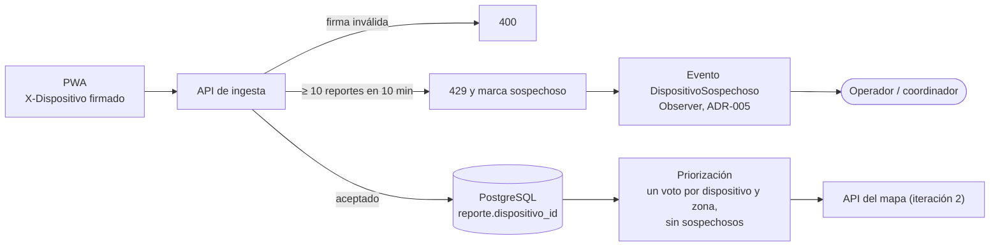

# ADD, iteración 3: seguridad frente a reportes falsos

## Resumen

| Punto | Registro |
|---|---|
| Objetivo | Escenario **S2** (H,M): ≤ 10 reportes aceptados por dispositivo en 10 min; 0 zonas cuya prioridad cambie por un único dispositivo; ≥ 99,5 % de los reportes legítimos aceptados; aviso al operador ≤ 5 min (paso 2) |
| Elemento refinado | API de ingesta, módulo de priorización, identificación del dispositivo en la PWA y eventos al operador (paso 3) |
| Conceptos evaluados | T9 identificar actores (límite por dispositivo), T10 limitar el acceso por IP, T11 detectar y reaccionar (marca y un voto por dispositivo), T12 autenticar actores (código por SMS) (paso 4) |
| Decisión | **T9 + T11 aceptadas**; T10 rechazada con la simulación; T12 rechazada con una comparación de alternativas (paso 4) |
| Evidencia | Simulación por conteo [fitness/simulacion_s2.py](../../../fitness/simulacion_s2.py), más una comparación de alternativas para lo que no se puede simular (paso 7) |
| ¿Se cumple S2? | **Sí con T9 + T11** en todas las variantes del estímulo de S2 (un mismo dispositivo). **No** frente a un atacante que cambia de identidad (Sybil), que queda como riesgo residual (paso 7) |

## Paso 1. Revisar las entradas

- **Drivers:** [escenarios.md](../utilidad/escenarios.md) (S2) y la Ley 29733 (R-04).
- **Iteraciones anteriores:**
  - [Iteración 1](iteracion-1.md) dejó el riesgo RI-02: durante el modo pico (T2) los reportes llegan sin foto, y los falsos pesan más en la priorización.
  - [Iteración 2](iteracion-2.md) definió la API del mapa por zona.
- **Decisiones vigentes:**
  - ADR-003: UUID por reporte y PWA offline.
  - ADR-005: Observer en [eventos.py](../../../src/modulo/eventos.py).
- **Restricciones:** R-01, R-02 y R-03, y que el ciudadano reporte en una situación de estrés (usabilidad, n.º 3 en drivers.md).

## Paso 2. Establecer el objetivo de la iteración

Se elige **S2** (H,M) por tres razones:

- La guía exige que al menos una iteración atienda disponibilidad o seguridad, y la iteración 1 ya atendió disponibilidad.
- S2 es el único escenario de seguridad con dificultad mayor que L en el árbol. S1 es (H,L).
- Cierra RI-02 de la iteración 1.

> **S2:** un atacante con un script envía 1 000 reportes falsos en 5 min desde un mismo dispositivo, durante el simulacro, mientras muchos ciudadanos legítimos comparten IP por la red del operador móvil (CGNAT). Medida: ≤ 10 reportes aceptados por dispositivo en 10 min; 0 zonas cuya prioridad cambie por reportes de un único dispositivo; ≥ 99,5 % de los reportes legítimos aceptados durante el ataque; aviso al operador ≤ 5 min.

## Paso 3. Elegir los elementos a refinar

| Elemento | Por qué se refina |
|---|---|
| API de ingesta | Hoy acepta todo reporte válido; no distingue quién lo envía |
| Módulo de priorización | Hoy suma todos los reportes de una zona, así que 1 000 reportes de un atacante valen como 1 000 ciudadanos |
| PWA (identificación) | El UUID de ADR-003 identifica al reporte, no al dispositivo |
| Eventos al operador | No hay aviso de comportamiento anómalo |

## Paso 4. Elegir los conceptos de diseño

### Tácticas candidatas (Bass et al., seguridad)

| Táctica | Categoría | Qué es en este sistema |
|---|---|---|
| T9. Identificar actores | Resistir ataques | La PWA obtiene un identificador de dispositivo firmado por el servidor. La API acepta como máximo 10 reportes por dispositivo en una ventana deslizante de 10 min |
| T10. Limitar el acceso | Resistir ataques | La API acepta como máximo 10 reportes por IP pública en 10 min |
| T11. Detectar intrusiones y reaccionar | Detectar y reaccionar | Combina tres cosas: (1) el dispositivo que supera el límite queda marcado como sospechoso y sus reportes no cuentan en la priorización hasta que un coordinador lo revise; (2) cada dispositivo cuenta como un solo voto por zona; (3) se avisa al operador |
| T12. Autenticar actores | Resistir ataques | El ciudadano verifica su número con un código por SMS antes de reportar |

### Trade-offs

| Táctica | Mejora | Empeora | Costo | Complejidad (1 dev) |
|---|---|---|---|---|
| T9 | Limita al atacante a 10 reportes y lo detecta en 4 s, sin afectar a los legítimos (100 %) | El identificador vincula los reportes de una persona: es un dato personal más (Ley 29733), con el mismo plazo de retención de S3. La PWA necesita red la primera vez para obtenerlo (ADR-003 ya la necesita para cargarse) | US$ 0 | Baja–media: 2 días-persona (emisión firmada, ventana deslizante en PostgreSQL) |
| T10 | Limita al atacante sin cambiar la PWA | Con CGNAT solo acepta el 36,69 % de los legítimos, genera 56 falsas alarmas y altera 12 de las 20 zonas prioritarias al bloquear reportes reales | US$ 0 | Baja: la configuración del proxy |
| T11 | Un dispositivo deja de poder empujar una zona aunque concentre sus 10 reportes en ella | La priorización cuenta dispositivos en vez de reportes: una familia que reporta 3 daños desde un solo celular pesa como un voto en esa zona. Hay una cola de dispositivos sospechosos que alguien debe revisar | US$ 0 | Media: 1–2 días-persona (columna `sospechoso`, cambio en el puntaje, evento con el Observer de ADR-005) |
| T12 | Cada reporte queda atado a un número verificado; dificulta además el ataque Sybil | Ver la comparación de abajo | US$ 400–1 000 por simulacro | Alta: un proveedor de SMS fuera de R-02 |

### Comparación de alternativas para T12 (no se puede simular)

| Criterio | T9 + T11 | T12 (código por SMS) |
|---|---|---|
| Funciona sin señal (RF-01) | Sí: el identificador se obtiene una vez y el reporte se crea sin conexión | **No:** el código se pide y se verifica con red, justo lo que falta tras el sismo |
| Pasos para el ciudadano | Ninguno extra | Escribir el número, esperar el SMS y escribir el código; en una red congestionada el SMS puede tardar minutos |
| Costo | US$ 0 | Supuesto (por verificar): US$ 0,02–0,05 por SMS × 20 000 = US$ 400–1 000 por simulacro, de 13 a 33 veces el presupuesto mensual (R-03) |
| Datos personales (Ley 29733) | Un identificador seudónimo | El número de teléfono, que identifica directamente a la persona |
| Tecnología | Python y PostgreSQL | Proveedor externo de SMS, fuera de R-02 |
| Ataque Sybil | No lo frena | Lo encarece: cada identidad cuesta un número de teléfono |

### Decisión

| Táctica | Decisión | Motivo |
|---|---|---|
| **T9** | **Aceptada** | Cumple el límite por dispositivo y el aviso sin rechazar reportes legítimos |
| **T11** | **Aceptada** | Sin T11, un dispositivo que concentra sus 10 reportes en una zona la mete en el top 20 (variante "1 zona"). Con T11, 0 zonas alteradas |
| T10 | **Rechazada** | Con CGNAT incumple la medida de legítimos por mucho (36,69 % frente a ≥ 99,5 %), y empeora al haber más CGNAT (14,82 % con 50 IP) |
| T12 | **Rechazada** | Rompe el reporte sin señal (RF-01), cuesta de 13 a 33 veces R-03 por simulacro, agrega pasos en una situación de estrés y recoge un dato personal directo |

## Paso 5. Instanciar elementos, asignar responsabilidades y definir interfaces

| Elemento | Responsabilidad nueva o cambiada |
|---|---|
| PWA | Al abrirse por primera vez con red, pide su identificador y lo guarda en IndexedDB; lo envía en cada reporte |
| API de ingesta | Verifica la firma del identificador; cuenta los reportes del dispositivo en los últimos 10 min; si ya hay 10, responde 429 y marca el dispositivo |
| Módulo de priorización | Puntaje de una zona = suma, por dispositivo no sospechoso, de la mayor gravedad que reportó en esa zona |
| Eventos (Observer, ADR-005) | Publica `DispositivoSospechoso` y avisa al operador |
| Panel del coordinador | Lista de dispositivos sospechosos para revisar o liberar |
| PostgreSQL | `reporte.dispositivo_id`, índice en `(dispositivo_id, recibido)` y tabla `dispositivo(id, emitido, sospechoso)` |

**Interfaces:**

```
POST /api/dispositivos
201 {"dispositivo": "<uuid>.<firma HMAC>"}

POST /api/reportes            (cabecera X-Dispositivo: <uuid>.<firma>)
201 reporte guardado
400 firma inválida
429 Retry-After: <s hasta que salga el reporte más antiguo de la ventana>
```

La firma impide que un atacante use el identificador de otra persona para agotar su límite. No impide pedir identificadores nuevos (ver el ataque Sybil en el paso 7).

## Paso 6. Bosquejar vistas y registrar decisiones



**Decisión por registrar:** candidata a ADR (E6): "Identificador de dispositivo con límite y un voto por zona". Contexto S2 y RI-02, alternativas T9 a T12, consecuencias del paso 4.

## Paso 7. Analizar el diseño y revisar el objetivo

### Evidencia: simulación por conteo

[fitness/simulacion_s2.py](../../../fitness/simulacion_s2.py) genera los reportes legítimos y los del atacante en una ventana de 10 min y les aplica cada táctica. Luego compara el top 20 de zonas prioritarias con el que darían solo los reportes legítimos. Se ejecuta con `python fitness/simulacion_s2.py` y deja las tablas en [fitness/resultados/s2.md](../../../fitness/resultados/s2.md).

### Supuestos de la simulación

| Parámetro | Valor | Origen |
|---|---|---|
| Reportes legítimos | 3 333 en 10 min (≈ 5,6 por s), de 3 000 dispositivos; el 10 % envía un segundo reporte | D1 |
| Zonas | 1 874, con reportes por zona lognormales (σ = 1); cada dispositivo reporta en su zona | Iteración 2 |
| CGNAT | Los dispositivos comparten 200 IP públicas con distribución de Zipf (exponente 1) | Supuesto |
| Ataque | 1 000 reportes de gravedad alta entre los segundos 120 y 420, desde un dispositivo, a las 5 zonas con menos reportes; la IP del atacante sale del mismo grupo de IP | S2 |
| Puntaje de una zona | Suma de pesos por gravedad (1, 2 y 4); con T11, un voto por dispositivo y zona | Supuesto |
| Prioridad | Las 20 zonas con mayor puntaje | Supuesto |
| Límite de T9 y T10 | 10 reportes en una ventana deslizante de 10 min | S2 |
| Réplicas | 10 (semillas 1 a 10); se informa la peor | — |

**Fuera del modelo:** el contenido de los reportes (texto o foto falsos), la verificación del brigadista y los ataques contra la red o el servidor.

### Resultados con los supuestos base (peor de 10 réplicas)

| Táctica | Máx. aceptados por dispositivo atacante (≤ 10) | Reportes falsos aceptados | Zonas del top 20 alteradas (0) | Legítimos aceptados (≥ 99,5 %) | Aviso al operador (≤ 300 s) | Falsas alarmas (media) | ¿Cumple S2? |
|---|---|---|---|---|---|---|---|
| Antes: sin control | 1 000 | 1 000 | 5 | 100,00 % | sin aviso | 0 | **No** |
| T10: límite por IP | 10 | 10 | 12 | **36,69 %** | 3,4 s | 55,9 | **No** |
| T9: límite por dispositivo | 10 | 10 | 0 | 100,00 % | 4,0 s | 0 | Sí |
| **T9 + T11** | 10 | 10 | 0 | 100,00 % | 4,0 s | 0 | **Sí** |

"Zonas del top 20 alteradas" cuenta las zonas prioritarias que no estarían en el top 20 si solo se contaran los reportes legítimos. En T10, la alteración no viene del ataque, sino de los reportes legítimos bloqueados.

### Variantes (peor de 10 réplicas)

| Variante | Antes | T10 | T9 | T9 + T11 |
|---|---|---|---|---|
| 50 IP públicas (más CGNAT) | No: 5 zonas alteradas | No: 14,82 % legítimos | Sí | **Sí** |
| 1 000 IP públicas (menos CGNAT) | No: 5 zonas | No: 52,87 % legítimos | Sí | **Sí** |
| Ataque concentrado en 1 zona | No: 1 zona | No: 36,69 % legítimos | **No: 1 zona alterada** | **Sí: 0 zonas** |
| Ataque repartido en 20 zonas | No: 20 zonas | No: 36,69 % legítimos | Sí | **Sí** |
| Sybil: identidad nueva cada 10 reportes | No: 5 zonas | No: 36,69 % legítimos | **No: 1 000 aceptados, 5 zonas, sin aviso** | **No: 1 000 aceptados, 5 zonas, sin aviso** |

### Lectura de la evidencia

1. **El límite por IP no sirve con CGNAT.** Detiene al atacante, pero también a la mayoría de los ciudadanos: acepta del 14,82 % al 52,87 % de los legítimos según cuántas IP compartan, todo por debajo del 99,5 %.
2. **T9 basta cuando el ataque se reparte, pero no cuando se concentra.** 10 reportes de gravedad alta en una zona tranquila la meten en el top 20. T11 lo evita porque un dispositivo vale un voto por zona: esa es la evidencia de que T11 aporta.
3. **El aviso llega en 4 s**, muy por debajo de los 300 s de S2, porque el atacante envía ≈ 3,3 reportes por s y supera el límite casi de inmediato.
4. **El ataque Sybil derrota a T9 y a T11.** Si el atacante pide un identificador nuevo cada 10 reportes, ninguno supera el límite, no hay aviso y las 5 zonas entran al top 20. Limitar la emisión de identificadores por IP choca con el CGNAT, como T10, y T12 se rechazó. Este ataque está fuera del estímulo de S2 ("un mismo dispositivo"), pero es el riesgo residual principal.

### ¿Se cumple S2?

| Parte de la medida | Antes | Después (T9 + T11) |
|---|---|---|
| ≤ 10 reportes aceptados por dispositivo en 10 min | **No (1 000)** | Sí (10) |
| 0 zonas cuya prioridad cambie por un único dispositivo | **No (5)** | Sí (0, también con el ataque concentrado) |
| ≥ 99,5 % de los legítimos aceptados | Sí (100 %) | Sí (100 %) |
| Aviso al operador ≤ 5 min | **No (sin aviso)** | Sí (4 s) |

**Conclusión:** S2 se cumple con T9 + T11 en todas las variantes del estímulo del escenario. No se cumple frente a un atacante que cambia de identidad, que queda registrado como riesgo residual.

### Riesgos y pendientes

| ID | Riesgo o pendiente | Cómo se cierra |
|---|---|---|
| RI-10 | Ataque Sybil: un atacante con muchos identificadores mete zonas en el top 20 sin aviso | Evaluar avisos por zona (muchos dispositivos nuevos en una zona tranquila) y exigir la verificación del brigadista antes de asignar brigadas a una zona sin otros reportes; se acepta como riesgo residual del MVP |
| RI-11 | El identificador de dispositivo es un dato personal (Ley 29733) | Aplicarle el plazo de retención y el borrado de S3 |
| RI-12 | Con un voto por dispositivo, varios daños reportados desde un mismo celular pesan como uno | Revisar con Defensa Civil si el puntaje debe contar reportes con fotos distintas |
| RI-02 (iteración 1) | Durante el modo pico, los reportes falsos influyen más en la priorización | **Cerrado** para un solo dispositivo con T9 + T11; sigue abierto frente a Sybil (RI-10) |
