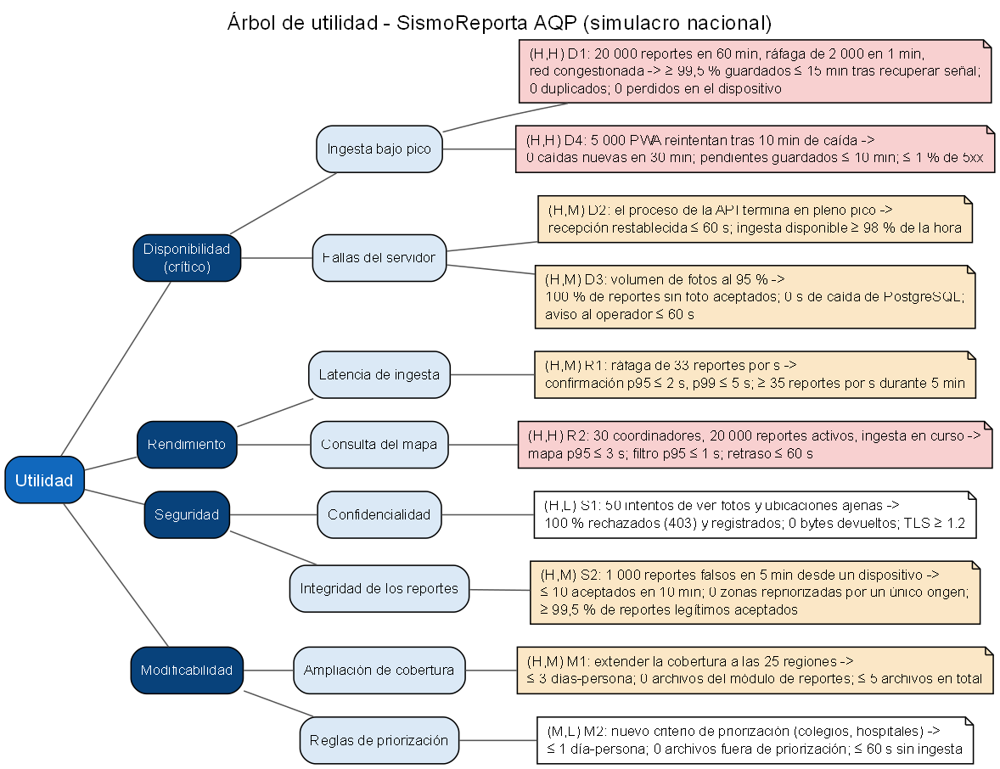

# E1: Escenarios de calidad y árbol de utilidad

## 1. Punto de partida

- **Drivers:** [drivers.md](../drivers.md) (QA-01 a QA-03) y [ADR-001](../adr/001-estilo-arquitectonico.md): monolito modular con ingesta asíncrona sobre un único servidor.
- **Escenario de crecimiento:** simulacro nacional, con 20 000 reportes en 1 hora y la red móvil congestionada. El sistema pasa de cubrir Arequipa a recibir reportes de las 25 regiones del país.
- **Atributo crítico:** disponibilidad.

Supuestos de carga usados en las medidas:

| Dato | Valor | Origen |
|---|---|---|
| Reportes en la hora del simulacro | 20 000 (≈ 5,6 por s en promedio) | Escenario de crecimiento |
| Ráfaga al restablecerse la red | 2 000 reportes en 1 min (≈ 33 por s) | Supuesto: 6 veces el promedio, porque los celulares reenvían la cola local a la vez |
| Reportes activos en el mapa | 20 000 | Todos los de la hora del simulacro |
| Coordinadores conectados | 30 (al menos uno por región) | Supuesto: 25 regiones y algunos coordinadores nacionales |
| Tamaño de los datos de un reporte sin foto | ≈ 1 KB | [bitacora-ia.md](../bitacora-ia.md), riesgo 32 |

Este documento solo describe escenarios. Las tácticas y decisiones quedan para las iteraciones de ADD (E2) y los ADR 006 a 008.

## 2. Escenarios candidatos

Escenarios de seis partes. Los que extienden un escenario de drivers.md lo indican en la columna ID.

| ID | Atributo | Fuente | Estímulo | Entorno | Artefacto | Respuesta | Medida |
|----|----------|--------|----------|---------|-----------|-----------|--------|
| D1 (QA-01) | Disponibilidad | Ciudadanos de las 25 regiones | Envían 20 000 reportes en 60 min, con una ráfaga de 2 000 en 1 min al volver la señal | Simulacro nacional, red móvil congestionada e intermitente, celulares de gama baja | PWA (cola local) y API de ingesta | Cada reporte se conserva en el dispositivo hasta que el servidor lo confirma; el servidor lo guarda una sola vez | ≥ 99,5 % de los reportes (≥ 19 900) guardados en el servidor ≤ 15 min después de recuperar la señal; 0 duplicados; 0 reportes perdidos en el dispositivo |
| D2 | Disponibilidad | Falla interna del servidor | El proceso de la API termina de forma inesperada a mitad del pico | Simulacro nacional, ≈ 5,6 reportes por s | API de ingesta | El sistema detecta la falla y vuelve a recibir reportes; los reportes no confirmados se reenvían desde los dispositivos | Recepción restablecida ≤ 60 s después de la falla; 0 reportes confirmados al ciudadano y luego perdidos; ingesta disponible ≥ 98 % de la hora (≤ 72 s fuera de servicio) |
| D3 | Disponibilidad | Crecimiento de las fotos almacenadas | El volumen de fotos llega al 95 % de su capacidad | Simulacro nacional, ingesta en curso | Almacenamiento de fotos, PostgreSQL y API de ingesta | Sigue recibiendo los datos de cada reporte, deja de aceptar fotos nuevas, le indica al ciudadano que la foto queda pendiente y avisa al operador | 100 % de los reportes sin foto aceptados mientras dure la condición; 0 s de caída de PostgreSQL; aviso al operador ≤ 60 s después de cruzar el umbral |
| D4 | Disponibilidad | 5 000 PWA con reportes pendientes | El servidor vuelve después de 10 min fuera de servicio y todas reintentan a la vez | Recuperación tras una caída, durante el simulacro | Servidor y API de ingesta | El servidor sigue en servicio, rechaza el exceso indicando cuándo reintentar y recibe los pendientes | 0 caídas nuevas en los 30 min siguientes; 5 000 reportes pendientes guardados ≤ 10 min; ≤ 1 % de respuestas 5xx (los rechazos por exceso, HTTP 429, no cuentan) |
| R1 | Rendimiento | PWA de los ciudadanos | Ráfaga de 2 000 reportes en 1 min (≈ 33 por s) | Simulacro nacional, worker activo y 30 coordinadores consultando el mapa | API de ingesta | Valida, guarda y confirma los datos de cada reporte | Tiempo de confirmación medido en el servidor para los datos sin foto (≈ 1 KB): p95 ≤ 2 s y p99 ≤ 5 s; ≥ 35 reportes por s sostenidos durante 5 min sin respuestas 5xx |
| R2 (QA-02) | Rendimiento | Coordinadores de Defensa Civil | 30 coordinadores abren el mapa nacional y lo refrescan cada 30 s | Ingesta de R1 en curso, 20 000 reportes activos | Panel web y API del mapa | Muestra los reportes agrupados por zona, con filtros por región y gravedad | Carga del mapa p95 ≤ 3 s; cambio de filtro p95 ≤ 1 s; retraso ≤ 60 s entre que un reporte se guarda y aparece en el mapa |
| R3 | Rendimiento | Ciudadano | Llega un reporte de gravedad alta | Simulacro nacional, 20 000 reportes por hora | Worker y módulo de priorización | Recalcula la prioridad de la zona del reporte | p95 ≤ 60 s y máximo ≤ 120 s entre que el reporte se guarda y la prioridad de su zona cambia |
| S1 (QA-03) | Seguridad | Usuario autenticado con rol ciudadano | 50 intentos de obtener la ubicación exacta y la foto de reportes ajenos, por identificador y por URL directa de la foto | Simulacro nacional | API de reportes, control de roles y entrega de fotos | Rechaza cada intento y lo registra | 100 % de los 50 intentos rechazados con HTTP 403; 100 % registrados con usuario, IP y hora; 0 bytes de foto o coordenadas exactas devueltos; 100 % del tráfico por TLS 1.2 o superior |
| S2 | Seguridad | Atacante con un script | Envía 1 000 reportes falsos en 5 min desde un mismo dispositivo | Simulacro nacional; muchos ciudadanos legítimos comparten IP por la red del operador móvil | API de ingesta y módulo de priorización | Limita los reportes aceptados de ese origen, evita que cambien la prioridad de una zona, lo registra y sigue recibiendo los reportes legítimos | ≤ 10 reportes aceptados por dispositivo en 10 min; 0 zonas cuya prioridad cambie por reportes de un único dispositivo; ≥ 99,5 % de los reportes legítimos aceptados durante el ataque; aviso al operador ≤ 5 min |
| S3 | Seguridad | Fin del plazo de retención (Ley 29733) | Se cumplen 30 días desde el cierre del simulacro | Operación normal, sin carga | Almacenamiento de fotos y PostgreSQL | Elimina las fotos y reduce la precisión de las ubicaciones de los reportes del simulacro | 100 % de las fotos eliminadas ≤ 30 días después del cierre; 100 % de las ubicaciones redondeadas a 3 decimales (≈ 110 m); 0 fotos recuperables desde la API |
| M1 | Modificabilidad | Defensa Civil | Pide extender la cobertura de Arequipa a las 25 regiones (zonas, coordinadores por región y filtro por región) | Desarrollo, 2 semanas antes del simulacro | Módulos de mapa, priorización y autenticación; datos de zonas | Se cargan las zonas, se crean los coordinadores regionales y se despliega el cambio | ≤ 3 días-persona; 0 archivos modificados en el módulo de reportes; ≤ 5 archivos de código modificados en total; 100 % de las pruebas existentes pasan |
| M2 | Modificabilidad | Coordinador | Pide un nuevo criterio de priorización: dar más peso a colegios y hospitales | Desarrollo, entre simulacros | Módulo de priorización | Se implementa, se prueba y se despliega el criterio | ≤ 1 día-persona; 0 archivos modificados fuera del módulo de priorización; ≤ 60 s de ingesta fuera de servicio durante el despliegue |
| M3 | Modificabilidad | Desarrollador | Cambia el proveedor del LLM que clasifica las descripciones | Desarrollo | Componente de IA ([ia/puerto.py](../../../src/modulo/ia/puerto.py)) | Se agrega un adaptador nuevo y se configura | ≤ 4 h-persona; 1 archivo nuevo; 0 cambios en `ia/puerto.py`, `ia/cache.py`, `ia/guardrails.py` y en el servicio |

## 3. Calificación (importancia, dificultad)

- **Importancia:** H si fallar el escenario arruina el simulacro o incumple la ley; M si lo degrada; L si no se nota durante el simulacro.
- **Dificultad:** H si exige cambiar el estilo de ADR-001 o pelear por los recursos del servidor único (R-03); M si exige trabajo nuevo dentro del estilo actual; L si la arquitectura actual ya casi lo cubre.

| ID | IA | Justificación de la IA | Final | En el árbol |
|----|----|------------------------|-------|-------------|
| D1 | (H,H) | Es el atributo crítico: un reporte perdido retrasa la ayuda. Es difícil porque la red congestionada y el borrado de datos de la PWA están fuera del control del servidor. | (H,H) | Sí |
| D2 | (H,M) | Sin ingesta no entra ningún reporte. En un servidor único no hay réplica, pero recuperar un proceso caído no exige cambiar el estilo. | (H,M) | Sí |
| D3 | (H,M) | Si PostgreSQL se cae por falta de disco se pierden todos los reportes, no solo las fotos. Exige separar el almacenamiento y vigilar un umbral, dentro del estilo actual. | (H,M) | Sí |
| D4 | (H,H) | Es el riesgo 34 de la bitácora: el servidor puede volver a caer apenas se levanta. Es difícil porque la carga la generan miles de clientes que el servidor no controla. | (H,H) | Sí |
| R1 | (H,M) | Si la confirmación tarda, la PWA reintenta y la carga se multiplica, lo que afecta a D1. La ingesta de ADR-001 ya solo guarda y responde. | (H,M) | Sí |
| R2 | (H,M) | El coordinador decide con el mapa. Se cuadruplican los reportes de QA-02 (de 5 000 a 20 000), pero es una consulta de lectura. | **(H,H)** | Sí |
| R3 | (M,M) | La priorización automática quedó fuera del MVP (veredicto del Prompt 2 en la bitácora) y el coordinador puede asignar a mano. El recálculo compite con la ingesta. | (M,M) | No |
| S1 | (H,L) | Exponer fotos y ubicaciones incumple la Ley 29733 (R-04). El control por roles ya existe (RF-06); falta cubrir la URL directa de las fotos. | (H,L) | Sí |
| S2 | (H,M) | Reportes falsos desvían brigadas. Distinguir al atacante es más difícil porque muchos ciudadanos comparten IP en la red móvil. | (H,M) | Sí |
| S3 | (M,L) | Es una obligación legal, pero no afecta al simulacro. Es una tarea programada sobre datos ya existentes. | (M,L) | No |
| M1 | (H,M) | Sin cobertura nacional no hay simulacro nacional. El modelo actual supone las zonas de Arequipa, pero los módulos ya están separados. | (H,M) | Sí |
| M2 | (M,L) | Afecta la calidad de la priorización, no su existencia. El módulo de priorización ya está aislado (ADR-004). | (M,L) | Sí |
| M3 | (L,L) | El LLM no participa en el flujo crítico. El puerto y el adaptador de ADR-005 ya separan al proveedor. | (L,L) | No |

### Corrección de la calificación de R2: de (H,M) a (H,H)

La IA calificó la dificultad de R2 como M porque el mapa es una consulta de lectura. Esa justificación ignora dos consecuencias negativas de ADR-001:

1. El servidor es único (R-03) y el worker comparte CPU, RAM y disco con la ingesta. La consulta del mapa corre sobre la misma PostgreSQL que, en la ráfaga de R1, recibe unas 33 escrituras por segundo.
2. El panel no se puede escalar por separado, porque todo es un solo despliegue en un solo servidor.

Además, R2 pide 4 veces más reportes que QA-02 (20 000 frente a 5 000) y 3 veces más coordinadores (30 frente a 10), con el mismo límite de p95 ≤ 3 s. Cumplir R2 sin romper R1 obliga a repartir recursos entre lectura y escritura en el servidor único, así que la dificultad es H.

### Escenarios que no entran al árbol

- **R3:** la priorización automática está fuera del MVP; se retoma si entra al alcance.
- **S3:** es (M,L) y no se pone a prueba durante el simulacro; se atiende como tarea aparte.
- **M3:** es (L,L) y ADR-005 ya lo cubre.

## 4. Árbol de utilidad

Fuente: [arbol.dot](arbol.dot) · Imagen: [arbol.png](arbol.png)

## 5. Lista de verificación

- [x] 10 escenarios seleccionados (6 o más) que cubren los 4 atributos, todos con medida numérica.
- [x] Ninguna medida dice "rápido", "seguro" o "fácil".
- [x] Se corrigió una calificación de la IA (R2) con justificación.
- [x] Al menos un escenario (H,H) o (H,M) por atributo:

| Atributo | Escenarios (H,H) o (H,M) |
|---|---|
| Disponibilidad (crítico) | D1 (H,H), D4 (H,H), D2 (H,M), D3 (H,M) |
| Rendimiento | R2 (H,H), R1 (H,M) |
| Seguridad | S2 (H,M) |
| Modificabilidad | M1 (H,M) |
